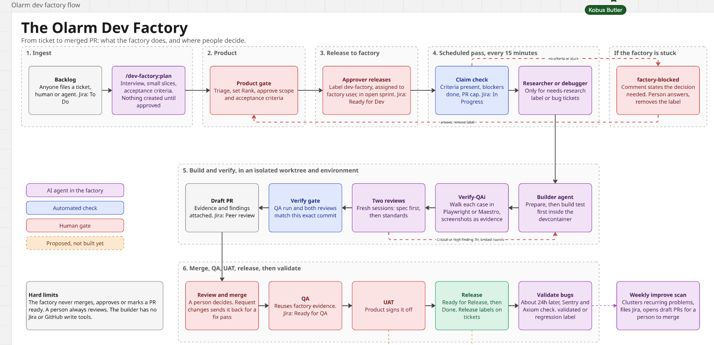

# dev-factory

Picks up Jira tickets labelled `dev-factory` from your open sprint, builds each in an isolated git worktree against a verified e2e environment, validates UI work by walking it through Playwright or Maestro MCP, and opens a draft PR with evidence. A person reviews and merges.

It is a Claude Code plugin kept in this repository. There is no database and no service to run: Jira holds ticket state, GitHub holds merge state, and each scheduled pass is one `claude -p` session.

## Quick start

You need a Mac with Docker, `gh` and Claude Code (the full list is under [Prerequisites](#prerequisites)). Run every command from the repository root.

### 1. Set it up once

```bash
bash dev-factory/scripts/doctor.sh            # prints ok, warn or FAIL per check; fix every FAIL
bash dev-factory/scripts/install.sh --apply   # creates dev-factory/.env.local, turns the plugin on for this machine, writes the scheduler files; starts nothing
claude                                        # the plugin is now loaded in this repository; run /mcp and log in to the servers listed under "Logins and tokens"
```

Then run `bash dev-factory/scripts/doctor.sh` again: it should print no `warn` except, until you set up the scheduler, the one about `CLAUDE_CODE_OAUTH_TOKEN` (that token only matters for scheduled passes; see [Logins and tokens](#logins-and-tokens)). Already inside a Claude Code session? See [Starting a session](#starting-a-session).

### 2. Write a ticket the factory can build

The easy way is to let the factory write it with you: start `claude --plugin-dir ./dev-factory` and run `/dev-factory:plan "what you want built"`. It interviews you, splits the work into small slices, shows you every description, and creates nothing until you approve.

By hand, a ticket must be in the open sprint, in Ready for Dev (or To Do), assigned to the factory user, labelled `dev-factory`, and its description needs an **Acceptance criteria** heading with at least one concrete, checkable bullet. Without one the factory refuses to guess: it labels the ticket `factory-blocked` and says why. Use this shape:

```text
Summary: one sentence on what changes and why.

Acceptance criteria
- Tapping Arm shows the armed banner within 2 seconds.
- A failed arm shows the error text and leaves the state unchanged.

Out of scope
- Disarm and the schedule screens.

Testing decisions
- First red test: the arm handler returns the armed state for a valid request.
```

To build on a branch other than `develop`, add one line to the description, `Base branch: feature/OAPP-1234-some-work` (the branch must be pushed; see [Choosing the base branch](#choosing-the-base-branch)). Link prerequisites with "is blocked by"; a ticket waits until each blocker is Done, UAT or Ready for Release. Tickets are taken in Rank order, so drag them on the board to prioritise.

### 3. Watch it build one ticket (recommended first run)

```bash
claude                      # plugin already enabled by install.sh --apply; otherwise: claude --plugin-dir ./dev-factory
/dev-factory:build OAPP-1234
```

You start `claude` once in your terminal and type the `/dev-factory:...` commands inside that session; stay in it for as many commands as you like. To run one command and keep the session open, pass it as the prompt: `claude "/dev-factory:build OAPP-1234"`. The scheduled passes need none of this; they start their own sessions. See [Starting a session](#starting-a-session).

This does the whole job for one ticket in your own session, so you can see every step: worktree, isolated environment, test-first build, QA walk, the two reviews, and a draft PR. It moves the ticket like a scheduled pass does: In Progress when it starts, Peer review once the draft PR is open, and back to To Do with `factory-blocked` and a comment if it gets stuck. Run `/dev-factory:status` afterwards to see the queue and the open factory PRs.

### 4. Let it run on its own

```bash
bash dev-factory/scripts/tick.sh                                # one unattended pass by hand: claims tickets, moves them in Jira
bash dev-factory/scripts/install.sh --load                      # run a pass every 15 minutes, and the weekly improvement scan
launchctl bootout gui/$(id -u)/com.olarm.dev-factory.tick       # stop the scheduler
```

By default a pass builds one ticket at a time, keeps at most 3 factory PRs open (`caps.maxOpenPrs`), and stops a session at 40 USD (`caps.maxBudgetUsd`). The Mac must be awake and online. A pass with nothing to do starts no paid session. That check needs `JIRA_API_TOKEN` and `JIRA_EMAIL` in `.env.local`; without them a pass starts nothing, so for a first manual run before you have the token use `DF_PREFLIGHT=off bash dev-factory/scripts/tick.sh`. Logs are in `~/Library/Logs/dev-factory-tick.log`.

### Day to day

| I want to                           | Do this                                                                                                                                                                                               |
| ----------------------------------- | ----------------------------------------------------------------------------------------------------------------------------------------------------------------------------------------------------- |
| Queue a ticket                      | Open sprint, Ready for Dev (or To Do), assigned to the factory user, label `dev-factory`, acceptance criteria in the description.                                                                     |
| Make a small change, no ticket      | `/dev-factory:quick "<change>"`: runs the whole flow in your session and opens a draft PR with the placeholder key `PLAT-000`. Jira is never touched.                                                 |
| Fix open comments on a PR           | `/dev-factory:quick --pr 1234 ["<extra instruction>"]`: reads the unresolved review threads, fixes them test-first, runs QA and both reviews, and pushes to the PR's branch.                          |
| Write tickets with help             | `/dev-factory:plan "<idea>"`                                                                                                                                                                          |
| See the queue, work in flight, PRs  | `/dev-factory:status`                                                                                                                                                                                 |
| Understand a failing check          | `/dev-factory:doctor`                                                                                                                                                                                 |
| Review the result                   | Open the draft PR (the ticket is in Peer review). It links the ticket and holds the QA verdict, screenshots and review findings. Review it as you would any PR, mark it ready, and merge it yourself. |
| Ask for changes                     | Submit a **Request changes** review on the PR, or comment `/dev-factory fix <what to change>` on the Jira ticket. A plain PR comment, from a person or a bot, does not start a new pass.              |
| Unblock a ticket                    | Read the `factory-blocked` comment on the ticket (the reason and the decision it needs), answer in a comment, then remove the label.                                                                  |
| Stop it                             | `launchctl bootout gui/$(id -u)/com.olarm.dev-factory.tick`. To keep one ticket out of the queue, take off its `dev-factory` label.                                                                   |
| Find out why a ticket is not picked | `/dev-factory:status`, then check the blockers, the sprint, the assignee and the label, and that fewer than 3 factory PRs are open.                                                                   |

### What the Jira state means for you

| State                                          | Meaning                                                                                 | Your move                              |
| ---------------------------------------------- | --------------------------------------------------------------------------------------- | -------------------------------------- |
| Ready for Dev or To Do, with `dev-factory`     | Queued; taken in Rank order once its blockers are done.                                 | Nothing, or reorder.                   |
| Ready for Dev or To Do, with `factory-blocked` | The factory stopped and left a comment with its reason and the decision it needs.       | Answer in a comment, remove the label. |
| In Progress                                    | Being built. A ticket quiet for 90 minutes is resumed, at most twice, and then blocked. | Wait.                                  |
| Peer review                                    | Draft PR open with evidence.                                                            | Review and merge.                      |
| Ready for QA                                   | The PR was approved or merged.                                                          | QA, UAT and release are yours.         |
| Impeded                                        | Someone moved it there; the factory leaves it alone.                                    | Your call.                             |

The factory never merges, approves, marks a PR ready, force-pushes, or pushes any branch but the ticket's own. The builder has no Jira or GitHub tools. See [Rules and their reasons](#rules-and-their-reasons) and [Known limits](#known-limits) for exactly what is and is not enforced.

## How a ticket flows



1. A ticket is in the open sprint, status Ready for Dev (or To Do), assigned to the factory user, labelled `dev-factory`, with no `factory-blocked` label.
2. `/dev-factory:tick` lists these in Rank order, drops any with an unresolved "is blocked by" link, checks the caps, and claims one by moving it to In Progress. Jira refuses a stale transition, so two passes cannot claim the same ticket.
3. A worktree and branch (`<type>/<KEY>-<slug>`) are created and `scripts/e2e-env.sh up` starts an isolated compose project. `verify` proves it matches the expected contract before any build starts.
4. The `factory-builder` agent works the ticket test-first inside the devcontainer, then QA walks each case through MCP and records it with `bin/qa.mjs`.
5. Two separate fresh-context reviewers run in order: step 1 checks the commit against the ticket (spec), step 2 checks it against the repository rules (standards). Critical or High findings send the builder back to fix, QA runs again, and review restarts at step 1, for at most `caps.maxFixRounds` rounds.
6. The builder then ships: pushes the branch and opens the draft PR. The pass re-verifies the QA manifest and both review records against the PR head, comments the PR and evidence on the issue, moves it to Peer review and tears the environment down.
7. You review the PR. A change request from someone other than the PR author, after the last commit, sends the ticket back to In Progress for a fix pass and then to Peer review again. When the PR is approved or merged the pass moves the ticket to Ready for QA. QA, UAT and release are yours; UAT, Ready for Release and Done count as done for the factory, and a person may move a ticket to Impeded at any stage.

## Starting a session

The `/dev-factory:...` commands exist only in a Claude Code session that has the plugin loaded. There are three ways to get one:

| Situation                                             | Do this                                                                                                                                                                                              |
| ----------------------------------------------------- | ---------------------------------------------------------------------------------------------------------------------------------------------------------------------------------------------------- |
| Plugin enabled on this machine (`install.sh --apply`) | Run `claude` from the repository root. Nothing else.                                                                                                                                                 |
| Not enabled, and you want it for one session only     | `claude --plugin-dir ./dev-factory`. The flag only works when Claude starts; it cannot be applied to a session that is already open.                                                                 |
| You are already inside a running session              | Run `! bash dev-factory/scripts/install.sh --apply`, then `/reload-plugins`. If `/dev-factory:quick` still does not appear, `/exit` and start `claude` again (`claude --continue` resumes the chat). |

`install.sh --apply` writes the plugin into `.claude/settings.local.json`, which is not committed, so:

-   It applies to this machine only; each teammate runs `install.sh --apply` themselves.
-   It records the absolute path of your checkout. If you move or re-clone the repository, run `install.sh --apply` again.
-   Start `claude` from the repository root of the main checkout. A session started inside a git worktree (such as `../.worktrees/...`) does not have that untracked file and probably will not load the plugin. A session started in a subfolder may not either.
-   Every session in the repository then registers the plugin's MCP servers (Playwright, Maestro, Atlassian, Sentry, Axiom and others) and hooks. The guards act only on factory agents and on a worktree that has a `run.json`, so ordinary sessions are not restricted, but the extra servers show up in `/mcp`. Use `--plugin-dir` instead if you do not want that.

`/dev-factory:status` is a safe first command: it only reads Jira and GitHub, so it also proves the Atlassian login works. It prints empty tables until a ticket has the `dev-factory` label.

## Logins and tokens

Log in from inside a session with `/mcp`. The plugin's servers are separate from any connections you already have in claude.ai or your user settings, even when the URL is the same, so each needs its own login.

| Server                                                             | Login                                                                                                     |
| ------------------------------------------------------------------ | --------------------------------------------------------------------------------------------------------- |
| `atlassian`                                                        | `/mcp`, authenticate once. Needed by `/dev-factory:status`, `plan`, `tick` and `validate`.                |
| `plugin:dev-factory:sentry`, `plugin:dev-factory:axiom`            | `/mcp`, authenticate each once. Read-only telemetry for the debugger; no tokens, no `.env.local` entries. |
| `playwright`, `maestro`, `context7`, `21st`, `sequential-thinking` | None. They run locally or are public. `CONTEXT7_API_KEY` is optional.                                     |

`bash dev-factory/scripts/doctor.sh` reports whether the Sentry and Axiom plugin servers are connected, and `claude mcp list | grep plugin:dev-factory` shows the state of every plugin server.

Things the servers still need from your machine, not a login:

-   Playwright needs the stack up on the canonical ports (`e2e-env.sh up --ports canonical`, which the factory runs for you) and downloads its browser on first use.
-   Maestro needs a booted iOS simulator for mobile changes. Boot one in Simulator first, or you get "no devices". Web-only changes do not need it.
-   Docker must be running (`docker info`).

### The unattended token (scheduler only)

`CLAUDE_CODE_OAUTH_TOKEN` lets scheduled passes run without your interactive login. You need it only before `install.sh --load`. `/dev-factory:build`, `quick`, `status` and the rest use your normal login and ignore it.

1. In a normal terminal tab, not inside Claude Code (the login needs a real terminal): `cd` to the repository and run `claude setup-token`. Finish the login in the browser and copy the token it prints.
2. In the same tab, put it in the environment, then write it into `dev-factory/.env.local` without printing it:

    ```bash
    export CLAUDE_CODE_OAUTH_TOKEN=<paste the token>
    grep -v '^CLAUDE_CODE_OAUTH_TOKEN=' dev-factory/.env.local > dev-factory/.env.local.new \
      && printf 'CLAUDE_CODE_OAUTH_TOKEN=%s\n' "$CLAUDE_CODE_OAUTH_TOKEN" >> dev-factory/.env.local.new \
      && mv dev-factory/.env.local.new dev-factory/.env.local \
      && chmod 600 dev-factory/.env.local \
      && grep -c '^CLAUDE_CODE_OAUTH_TOKEN=.\+' dev-factory/.env.local
    ```

    It prints `1` when the line is filled in. Do not use `sed` with the clipboard: a clipboard that holds anything else (or text containing `|`) breaks the substitution.

3. Tidy up: `unset CLAUDE_CODE_OAUTH_TOKEN` (left exported, every `claude` started in that tab uses this token instead of your login), remove the `export` line from your shell history or close the tab, and clear the clipboard. Never paste the token into a chat or a ticket.

Where the token lives: `dev-factory/.env.local` is gitignored (the doctor fails if it is ever tracked), mode 600, is read by `tick.sh` at run time (so it is not copied into the launchd plist), and the shell guard stops factory agents reading env files. It is still plain text on disk: do not sync or back up the repository directory to a place you do not trust. If it leaks or the login expires, run `claude setup-token` again and replace the line.

`JIRA_API_TOKEN` and `JIRA_EMAIL` go in the same file the same way. They are needed by the idle-pass check, and as the fallback if the Atlassian login does not survive unattended runs.

## Prerequisites

| Need                                                                           | Check                                               |
| ------------------------------------------------------------------------------ | --------------------------------------------------- |
| Node matching `.nvmrc` (24)                                                    | `node -v`                                           |
| Claude Code 2.1.275 or newer                                                   | `claude --version`                                  |
| `gh` signed in with access to `OlarmTech`                                      | `gh auth status`                                    |
| Docker with Compose v2                                                         | `docker info`                                       |
| `*.olarm.local` entries in `/etc/hosts`                                        | see `MANUAL_SETUP.md`                               |
| Atlassian access (Jira cloud id in `.env.example`)                             | authenticated once through `/mcp`, see step 4 below |
| Mobile tickets only: Xcode, an iOS simulator runtime, Maestro, yarn, CocoaPods | `xcrun simctl list runtimes`, `maestro --version`   |

`bash dev-factory/scripts/doctor.sh` checks all of this and prints `ok`, `warn` or `FAIL` per line. Run it from anywhere in the repository.

## Set up

Run everything from the repository root.

1. Check the machine: `bash dev-factory/scripts/doctor.sh`. Fix every `FAIL`.
2. Preview the installer, then apply it:

    ```bash
    bash dev-factory/scripts/install.sh          # dry run, prints what it would do
    bash dev-factory/scripts/install.sh --apply  # creates dev-factory/.env.local and the launchd plist, does not start the scheduler
    ```

3. Review `dev-factory/config.json`, the shared settings: Jira projects, label, status names, branch types, PR label rules, caps (open PRs, concurrency, fix rounds, spend), and the model and effort per role. Then edit `dev-factory/.env.local` (gitignored, mode 600), which holds secrets and optional per-machine overrides (any `DF_*` variable overrides `config.json`; the names are in `.env.example`):

    | Variable                       | Meaning                                                                                                                                               |
    | ------------------------------ | ----------------------------------------------------------------------------------------------------------------------------------------------------- |
    | `CLAUDE_CODE_OAUTH_TOKEN`      | Output of `claude setup-token`, used by unattended passes                                                                                             |
    | `JIRA_API_TOKEN`, `JIRA_EMAIL` | Needed for the idle-pass check (no paid session when nothing is claimable); also the fallback if the Atlassian login does not survive unattended runs |
    | `CONTEXT7_API_KEY`             | Optional, raises the context7 rate limit                                                                                                              |

    To make the factory watch another Jira project, add its key to `jira.projects` in `config.json` (shared, so everyone gets it) or set `DF_JIRA_PROJECTS=OAPP,PLAT,ONE,MAX` in `.env.local` (this machine only; the line in `.env.example` is commented out and does nothing until you remove the `#`). The queries quote every key, because some project keys, such as `MAX`, are reserved JQL words that Jira otherwise rejects.

    `node dev-factory/scripts/config.mjs validate` checks the file, and `doctor.sh` runs it.

4. Log in once: start `claude`, run `/mcp`, and authenticate `atlassian` and the plugin's `sentry` and `axiom` servers (see [Logins and tokens](#logins-and-tokens)). Then run one unattended pass by hand (see below) and confirm it can still read Jira. If it cannot, set the fallback variables and replace the `atlassian` server in `.mcp.json` with an API-token one.
5. Make sure the plugin is enabled on this machine only. `install.sh --apply` writes it into `.claude/settings.local.json`, which is not committed: the plugin registers Atlassian, Sentry, Axiom, Playwright and Maestro servers and hooks, so the shared `.claude/settings.json` deliberately leaves it off and a normal session on another machine never loads it. Scheduled passes load it with `--plugin-dir`. By hand: `node dev-factory/scripts/enable-plugin.mjs .claude/settings.local.json "$PWD/dev-factory"`.
6. Start the scheduler only when you want unattended passes: `bash dev-factory/scripts/install.sh --load`. It runs `scripts/tick.sh` every 15 minutes and also loads the weekly `improve` entry. Stop it with `launchctl bootout gui/$(id -u)/com.olarm.dev-factory.tick`.

Ask a Jira admin to allow a `factory-blocked` label and, optionally, to enable the GitHub for Jira merge automation.

## MCP servers and plugins

MCP servers ship inside the plugin (`.mcp.json`). Plugin tools are named `mcp__plugin_dev-factory_<server>__*`.

| Server                | Used by             | Purpose                                                                                     |
| --------------------- | ------------------- | ------------------------------------------------------------------------------------------- |
| `playwright`          | builder             | Web QA, run inside the devcontainer when an environment is up, isolated per session         |
| `maestro`             | builder             | Mobile QA against the simulator                                                             |
| `context7`            | builder, reviewers  | Current library and framework documentation; set `CONTEXT7_API_KEY` to raise the rate limit |
| `21st`                | builder             | UI component search for UI tickets; results are adapted to the repository's design system   |
| `sequential-thinking` | builder             | Structured reasoning for hard design decisions                                              |
| `atlassian`           | scheduled pass only | Jira reads, transitions and comments; the builder and reviewers do not get it               |

Plugins are listed in `plugins.json` and installed per user with `install.sh --apply` (scope `local`, nothing committed): `superpowers` is required (test-driven development, systematic debugging, verification before completion); `frontend-design` and `code-simplifier` are optional (`DF_INSTALL_OPTIONAL=1`). Scheduled passes enable them through `settings.factory.json`, which also switches off the `playwright` plugin because its browser is shared between sessions. GitHub goes through the `gh` CLI under the guard rules, not an MCP server.

## Using the factory

### Hand it a ticket

1. Create or pick a ticket in the open sprint. Put the acceptance criteria in the description; the builder works from them and from `CLAUDE.md` and `.cursor/rules`.
2. Assign it to the factory user (the account whose login the Atlassian MCP uses).
3. Add the label `dev-factory`. Order tickets by dragging them on the board; the pass takes them in Rank order.
4. Link prerequisites with "is blocked by". A ticket stays out of the queue until each blocker is done (UAT, Ready for Release or Done).

### Run one ticket yourself, watching

```bash
claude --plugin-dir ./dev-factory
# then
/dev-factory:build OAPP-1234
```

This does the same work as a scheduled pass for one ticket, in your session, including the Jira moves above. `/dev-factory:build OAPP-1234 --base feature/OAPP-1200-other` builds on that branch instead of `develop`.

### Run a scheduled pass by hand

```bash
bash dev-factory/scripts/tick.sh
```

Logs go to `~/Library/Logs/dev-factory-tick.log`. Exit code 75 means another pass is still running.

### See what is going on

`/dev-factory:doctor` explains every failed machine or configuration check. `/dev-factory:status` prints the queue, tickets in flight, open factory PRs, running environments and the tail of the last pass.

### Review and merge

The draft PR carries a Jira link, the QA run and verdict, evidence screenshots, and a Review section with the two-step counts and every Medium and Low finding. The reviewers are separate sessions but the same model family as the builder, so your review is still required. Mark the PR ready and merge it yourself; the factory never merges or approves.

### Choosing the base branch

Every run builds on a branch and opens its PR into it. The base is the first of:

1. `--base <branch>` on `/dev-factory:build` or `/dev-factory:quick` (a fix on an existing PR always keeps that PR's own base).
2. A `Base branch: <branch>` line in the Jira description.
3. `git.baseBranch` in `config.json`, which is `develop`.

The worktree is cut from `origin/<base>`, so it is the pushed state of that branch, not whatever you have checked out. Reviews and the QA gate measure only the work on top of the base, and the PR's size label counts against it. A base must be on `origin` and your local copy must not be ahead of it, because the factory never pushes a base branch and a PR needs the same commits on both sides. When a base cannot be used, the factory says why and stops (a scheduled pass blocks the ticket) without building anything: push the branch, or correct the line. `node dev-factory/scripts/worktree.mjs resolve --base <branch>` checks a branch without creating anything.

### Make a change without a ticket

`/dev-factory:quick` runs the whole flow (worktree, isolated environment, test-first build, QA walk, the two reviews) in your session for work that has no Jira ticket. It never touches Jira.

```text
/dev-factory:quick "make the arm banner text match the design"
/dev-factory:quick "add the missing null check" --base feature/OAPP-1200-other
/dev-factory:quick --pr 1234
/dev-factory:quick --pr 1234 "only the two comments on the arm handler"
```

-   A description starts a new change: the command writes 2 to 5 checkable criteria and shows them, then opens a draft PR on `<type>/PLAT-000-<slug>` titled `... [PLAT-000]`. CI requires a Jira key in both, and `PLAT-000` is the placeholder the repository already uses for housekeeping.
-   `--pr <number>` fixes review feedback on an open PR: it reads the unresolved, non-outdated review threads (bots included) and any change requests, shows you the numbered list so you can drop items, fixes them test-first, runs QA and both reviews, and pushes to the PR's branch. No new PR is opened. It asks first when the PR is someone else's.
-   It never posts, resolves threads, marks ready or merges. When it finishes it offers to post one summary comment on the PR, scrubbed first.
-   QA cases for a `PLAT-000` run live in `dev-factory/qa/cases/PLAT-000/` and each run replaces what is there, because QA walks every case in the directory.
-   Too big for one slice (several areas, a schema or API contract change, a design decision)? It says so and points you to `/dev-factory:plan`.
-   `--pr` needs a branch that is not already checked out in your main checkout (a worktree cannot check out a branch that is checked out elsewhere), so switch the main checkout to another branch first. It also stops when there is nothing open to fix. Do not point it at changes to the factory's own guards (`scripts/guard-*`, `edit-guard`, `mcp-guard`, `hooks/`, `bin/qa.mjs`): factory agents may not edit those, so that work stays with a person.

### Ask for changes

Either move the issue back to Ready for Dev or To Do (the label stays) or comment `/dev-factory fix` on it with what to change. The next pass continues on the same branch.

### Unblock a ticket

When the factory cannot continue it adds the label `factory-blocked`, comments the reason and the decision it needs, and moves the issue back to To Do (the one queue status Jira lets an In Progress ticket return to). Answer in a comment, then remove the label to put the ticket back in the queue. If two tickets were blocked within six hours the pass stops claiming new work until you look.

## Planning, preparation and debugging

-   `/dev-factory:plan "<idea>"` is the interactive way to write tickets the factory can build: an interview, tracer-bullet slices with blocking edges, and descriptions with Acceptance criteria, Out of scope and Testing decisions, each checked with `qa.mjs ticket lint --strict true` before it is created.
-   At claim the pass runs `qa.mjs ticket lint` on the description. A ticket with no acceptance criteria is labelled `factory-blocked` with the reason `needs acceptance criteria` instead of being built on guesses.
-   A ticket labelled `needs-research`, or with a `Research:` block, first goes to `factory-researcher` (read-only, at most 3 hops), which writes `docs/plans/<KEY>/research.md`.
-   A bug, or a ticket linking a Sentry issue or Axiom query, first goes to `factory-debugger` (triage): it reproduces, finds the root cause, and records it with `qa.mjs debug`. The builder starts from that record, and the stop gate refuses `build.done` on a bug ticket without one. If the builder hits its fix budget (three attempts per failing test) it writes `needs_debug.json` and the debugger runs again (unstick) with fresh context; a repeated fingerprint or a spent budget (`debug.maxDebugRounds`, `debug.debugMinutes`) blocks the ticket.
-   `/dev-factory:validate KEY`, and a scheduled section of the pass, check after the merge whether the Sentry event count or Axiom signature fell, comment aggregates only, and label the issue `factory-validated` or `factory-regression`.

## Specialist review steps

After spec and standards, the diff paths in `review.specialistAxes` can trigger a `data`, `infra` or `security` step with its own checklist in `skills/review`. `qa.mjs review status` lists the `triggered` steps and `verify --require-review true` needs each one clean.

## Strays and the preflight

-   A session killed mid-build leaves an issue In Progress. The pass resumes any labelled In Progress issue quiet for `caps.stallMinutes`, at most `caps.maxResumes` times, then blocks it.
-   `tick.sh` first runs `scripts/frontier.mjs check` (needs `JIRA_API_TOKEN` and `JIRA_EMAIL`) and starts a paid session only when it exits 0: a claimable ticket, an orphaned one, or a Peer review PR that is approved, merged or has a fresh change request. Exit 20 logs "nothing to do" and ends the pass. Any other result, a Jira or `gh` failure or a missing token, logs why and starts nothing, so a Jira outage never costs four paid sessions an hour. `DF_PREFLIGHT=off` starts the session without the check (for a first manual pass before the token is set up). An unchanged frontier a session already looked at is not dispatched again for `caps.frontierRepeatHours`. A comment on a PR, from Bugbot, CI or a person, never starts a fix pass; a formal change request or `/dev-factory fix` on the Jira issue does.
-   Fix passes merge the base branch first (a conflict blocks), read the PR review threads, and treat a `CONFLICTING` PR as a fix item.

## Self-improvement

-   Every ticket pass appends a record to `~/.dev-factory/runs/runs.jsonl` (`scripts/run-record.mjs`) and a counts-only comment on the issue. `tick.sh` records session cost per pass.
-   Learnings are short and live in the PR body, never as files in the repository: at most 3 entries per ticket, each one or two sentences (300 characters) plus a `scope:` path. They are mandatory after a debug round or a Critical or High review finding; `qa.mjs learnings check --key KEY --body-file F` enforces the format and that the PR body carries them. At ship, `run-record.mjs learnings` also adds them to a small index in `~/.dev-factory/learnings.jsonl`.
-   Before a build, the pass gives the builder up to five recent learnings whose scope matches the paths the ticket mentions (`run-record.mjs preload`, at most about 1,500 characters), and the builder reads the `AGENTS.md` files from each touched directory up to the root.
-   Promotion: a learning that recurred on at least two tickets, or that you confirm by commenting `/dev-factory promote` on its PR, is turned by `factory-promoter` into one rule line in the `## Learned rules` section of the closest `AGENTS.md` (`improvement.agentsRuleCap` lines at most per file, each ending with its evidence ticket keys). It opens a draft PR that touches only those sections (`qa.mjs promote check` proves it) and you merge it. `CLAUDE.md` and `.cursor/rules` stay human-edited.
-   `/dev-factory:improve` runs weekly (`scripts/improve.sh`, a second launchd entry, Monday 07:00) or by hand. It clusters recurring causes across different tickets, deduplicates against open issues labelled `dev-factory-improvement`, files at most `improvement.maxTicketsPerScan` Jira issues, and for findings confined to `dev-factory/` opens at most `improvement.maxPrsPerScan` draft PRs through `factory-improver`, each reviewed by the two-step review first. `IMPROVEMENT-PLAN.md` is the prioritised list. The improver cannot edit what enforces the factory's own limits (guards, stop gate, `qa.mjs`, hooks, settings, `config.json`); those go to Jira for a person. Nothing is merged without you.

## Two-step review

After QA the scheduled pass runs two reviews of the same commit, each in a fresh read-only session, in this order:

1. `spec`: does the commit do what the ticket asks, and nothing more? Every acceptance criterion is mapped to code and a test.
2. `standards`: does it follow `CLAUDE.md` and the matching `.cursor/rules`, and is it safe (security, errors, concurrency, migrations, tests)?

Each reviewer records its result with `qa.mjs review record`, giving findings as `{severity, file, line, note}`; the counts are computed from the findings. `qa.mjs` refuses step 2 until step 1 is clean at that commit. Critical and High findings block: the builder fixes them, QA runs again, and review restarts at step 1 on the new commit. Medium and Low findings go into the PR body. `verify --require-review true` is the gate before a ticket moves to In Review. See `skills/review/SKILL.md` for the severity scale.

## Environments

`scripts/e2e-env.sh` runs the same sequence the CI e2e workflows run inline (compose up, `startup.sh --use-npmci`, `startup-pm2.sh`, readiness poll) against a compose project named `df-<ticket key>`.

| Command                                                  | What it does                                                                                                                                                                                             |
| -------------------------------------------------------- | -------------------------------------------------------------------------------------------------------------------------------------------------------------------------------------------------------- |
| `e2e-env.sh up --key KEY [--ports canonical] [--device]` | Start and verify. Exit 75 means a cap or the ports lock refused it, so try again on a later pass.                                                                                                        |
| `e2e-env.sh verify`                                      | Compose config renders, services healthy, pm2 processes match `ecosystem.config.js`, API ping answers.                                                                                                   |
| `e2e-env.sh down`                                        | Remove the project and its volumes.                                                                                                                                                                      |
| `e2e-env.sh sweep`                                       | Remove `df-*` projects that have no live owner, except one whose worktree's `run.json` changed in the last 3 hours (`DF_SWEEP_SPARE_MINUTES`): that ticket is about to be resumed. Safe to run any time. |

Isolated mode (`--ports none`, the script default) publishes no host ports, so several worktrees can coexist, but the host Playwright browser cannot reach it: web QA needs `--ports canonical`, which the scheduled pass uses whenever `caps.maxConcurrent` is 1 and which takes a machine-wide lock (exclusive per machine; the environment records `webBaseUrl`). An in-container browser bridge for concurrent web QA is a follow-up. `--device` implies canonical ports for the mobile app; it also runs `scripts/mobile-env.sh` to boot the simulator, start Metro from the worktree on `DF_METRO_PORT` (default 8081) and build the app only when native inputs changed.

Run state lives in `.dev-factory/` inside each worktree (gitignored). Machine state lives in `~/.dev-factory/`.

## QA evidence

`node dev-factory/bin/qa.mjs` is the only thing that can mark a case as passed.

| Command                                                                             | Purpose                                                  |
| ----------------------------------------------------------------------------------- | -------------------------------------------------------- |
| `start --key KEY --profile web\|mobile`                                             | Bind a run to the current commit; refuses a dirty tree   |
| `record --run N --case SLUG --status pass\|fail --assertion TEXT --screenshot FILE` | Record one walked case                                   |
| `done --run N`                                                                      | Close the run and compute the verdict                    |
| `mark-na --key KEY --profile P --reason TEXT`                                       | Declare no UI surface changed, verified against the diff |
| `review record --axis spec\|standards --head SHA --summary TEXT --findings JSON`    | Record one review step; step 2 needs a clean step 1      |
| `review status [--head SHA]`                                                        | Show both steps and whether the commit is clean          |
| `verify --head SHA --run N [--require-review true]` (or `--key KEY`)                | Confirm a passing result for exactly this commit         |

Cases are authored per ticket under `qa/cases/<KEY>/` (`.spec.ts` for Playwright, `.yaml` for Maestro). Which paths count as UI is configured in `qa/profiles.yaml` (`uiGlobs`); `nonUiGlobs` carves documentation out of them, so a diff that only changes Markdown under `clients/mobile/src/` is still "no UI surface" and `mark-na` accepts it, while a code file beside it needs a walk.

## Rules and their reasons

-   The debugger and researcher cannot edit code; the improver cannot edit what enforces the factory's own limits.
-   The builder cannot write Jira or merge. The scheduled pass is the only holder of those tools, so a ticket cannot approve itself.
-   A QA pass needs a fresh screenshot of this run at this commit, with an assertion that describes this walk; otherwise "passed" is only the model's word.
-   Services are installed and tested in the devcontainer, never on the macOS host (see the repository `CLAUDE.md`).
-   Only the ticket's own branch may be pushed, never forced. The shell guard reads git past global options (`-c`, `-C`), wrappers (`command`, `env`, `xargs`, an absolute path) and `sh -c` or `$(...)` payloads, and treats `gh api` with a body field or `--input` as a write.
-   Inside a run, the factory's own files (`dev-factory/`, `.claude/`, `.github/`), the run state and the QA and review records cannot be edited or overwritten by a ticket, by tool or by shell; a hook refuses it, including inline interpreter code (`node -e`, `python -c`, `awk`) that could write them unseen. Review records can only be written by `qa.mjs review record`, which refuses anyone whose `run.json` role is not the reviewer of that axis, and `verify` refuses a record not stamped by a reviewer. Debug rounds (`qa.mjs debug open|run|record|block`) likewise need the debugger role; `debug status` is open to all.
-   Edits under `dev-factory/` are always checked against the vocabulary lint.
-   Nothing is retried on its own after a block. A person decides.

## Telemetry (Sentry and Axiom, read-only)

The `sentry` and `axiom` MCP servers are reachable only by the debugger role. They authenticate through OAuth, not tokens: run `/mcp` once and authenticate the plugin's `sentry` and `axiom` servers (a Sentry or Axiom connection you already have in claude.ai or your user settings is not reused: the plugin's servers need their own login); `doctor.sh` reports whether both are connected. Rules are enforced by `scripts/mcp-guard.mjs` (PreToolUse), not by instruction: tools whose name is a write verb are denied, an Axiom query naming a dataset outside `environments.*.axiomDatasets` is denied, and `limit`, `take` and time windows above `telemetry.maxRows` and `telemetry.maxWindowDays` are denied. Nothing raw is written to files, PR bodies or Jira comments: `node dev-factory/bin/qa.mjs scrub --file F` fails on emails, phone numbers, JWTs, bearer tokens, long hex identifiers and `telemetry.scrubPatterns`.

## Settings reference (extended blocks)

All in `config.json`, validated by `scripts/config.mjs`.

| Key                                                   | Meaning                                                                                                                                                                                                                                        |
| ----------------------------------------------------- | ---------------------------------------------------------------------------------------------------------------------------------------------------------------------------------------------------------------------------------------------- |
| `jira.statuses`, `jira.doneStatuses`, `jira.bugTypes` | Status names the pass moves tickets between, the statuses that count as done, and the issue types that count as bugs. Workflows differ per issue type, so the pass picks the transition by its target status and comments when none is offered |
| `models.<role>`, `models.efforts.<role>`              | Model per role (`orchestrator`, `builder`, `reviewer`, `debugger`, `researcher`, `improver`); `models.efforts` overrides `models.effort` for one role                                                                                          |
| `caps.maxResumes`, `caps.frontierRepeatHours`         | Resumes of an orphaned ticket before it is blocked; hours before an unchanged frontier is looked at again                                                                                                                                      |
| `environments.<dev\|staging\|prod>`                   | Sentry org and projects and the Axiom datasets the debugger may read in that environment                                                                                                                                                       |
| `telemetry.maxRows`, `maxWindowDays`, `scrubPatterns` | Result size caps and extra patterns the scrub check refuses                                                                                                                                                                                    |
| `debug.maxDebugRounds`, `debug.debugMinutes`          | Debug budget per ticket                                                                                                                                                                                                                        |
| `validation.minHoursAfterMerge`                       | Wait before post-merge validation                                                                                                                                                                                                              |
| `improvement.*`                                       | Jira project, label and per-scan caps for the self-improvement scan                                                                                                                                                                            |
| `review.specialistAxes`                               | Globs that trigger the extra `data`, `infra` and `security` review steps                                                                                                                                                                       |

## Layout

| Path                           | Purpose                                                                                |
| ------------------------------ | -------------------------------------------------------------------------------------- |
| `commands/`                    | `tick`, `build`, `quick`, `plan`, `validate`, `status`, `doctor`                       |
| `agents/factory-builder.md`    | Per-ticket worker with a restricted tool list (no Jira, no GitHub write tools)         |
| `agents/factory-reviewer.md`   | Read-only reviewer for one axis of one commit, dispatched by the scheduled pass        |
| `agents/factory-debugger.md`   | Read-only debugger: triage, unstick, validate; records through `qa.mjs debug`          |
| `agents/factory-researcher.md` | Read-only researcher writing `docs/plans/<KEY>/research.md`                            |
| `agents/factory-improver.md`   | Implements one improvement to `dev-factory/` and opens a draft PR                      |
| `skills/`                      | `implement`, `qa`, `review`, `ship`, `environment`, `diagnose`, `telemetry`, `improve` |
| `hooks/hooks.json`             | Shell guard and stop gate, active only inside a factory run                            |
| `plugins.json`                 | Plugins the factory relies on and the one it disables                                  |
| `scripts/`                     | `e2e-env.sh`, `mobile-env.sh`, `tick.sh`, `install.sh`, `doctor.sh`, hook scripts      |
| `bin/qa.mjs`                   | QA, review, debug, scrub, ticket lint and learnings CLI                                |
| `qa/profiles.yaml`             | Web and mobile profiles                                                                |
| `config.json`                  | Shared settings: Jira, git, PR labels, caps, models                                    |
| `settings.factory.json`        | Sandbox and permission settings applied to scheduled runs only                         |
| `launchd/`                     | Scheduler template rendered by `install.sh`                                            |
| `test/`                        | `node --test dev-factory/test/*.test.mjs`                                              |

## Troubleshooting

| Symptom                                                             | What to do                                                                                                                                                                                                                                                                                            |
| ------------------------------------------------------------------- | ----------------------------------------------------------------------------------------------------------------------------------------------------------------------------------------------------------------------------------------------------------------------------------------------------- |
| Pass exits 75 immediately                                           | Another pass holds `~/.dev-factory/tick.lock`. If none is running, delete the directory.                                                                                                                                                                                                              |
| `environment busy, retrying next pass`                              | The device lock or the stack cap is held. `bash dev-factory/scripts/e2e-env.sh sweep` clears stale owners.                                                                                                                                                                                            |
| `verify FAILED` with a pm2 diff                                     | A service did not start. Read the diff, then `docker compose -p df-<key> exec devcontainer pm2 logs`.                                                                                                                                                                                                 |
| API, MQTT and worker crash-loop on `#olarm-proto/...`               | The `services/olarm-proto` submodule was empty in the worktree. `e2e-env.sh up` now populates it from your main checkout's copy before building; if it cannot (no copy and no SSH access to the proto repo), run `git submodule update --init services/olarm-proto` in the worktree, then `up` again. |
| Port 8081 held by another process                                   | Something else is running Metro. Stop it yourself; the factory never kills a process it did not start.                                                                                                                                                                                                |
| Builder says a tool is not allowed                                  | Plugin MCP tools are named `mcp__plugin_dev-factory_<server>__*`. Check the real names in the `system/init` event of `claude -p --output-format stream-json --verbose`.                                                                                                                               |
| Jira tools fail in unattended passes only                           | The Atlassian login did not survive. Use the API-token fallback in `.env.local` and `.mcp.json`.                                                                                                                                                                                                      |
| Guard blocks a command                                              | It is working as designed. Read its message; the allowed route is almost always a container exec or a PR comment.                                                                                                                                                                                     |
| Login expired                                                       | Run `claude setup-token` again and update `CLAUDE_CODE_OAUTH_TOKEN`.                                                                                                                                                                                                                                  |
| `/dev-factory:...` commands are missing                             | The session has no plugin loaded. See [Starting a session](#starting-a-session): `install.sh --apply` then `/reload-plugins`, or restart `claude`.                                                                                                                                                    |
| `plugin:dev-factory:sentry` or `axiom` shows "Needs authentication" | Run `/mcp` and authenticate it. Your claude.ai connection of the same name does not count.                                                                                                                                                                                                            |
| `claude setup-token` prints no token                                | Run it in a normal terminal tab, not through `!` inside a session. Finish the browser login, then copy the printed token.                                                                                                                                                                             |
| Maestro reports no devices                                          | Boot an iOS simulator first.                                                                                                                                                                                                                                                                          |

## Known limits

-   `qa.mjs` reads its QA profiles from the plugin, so a worktree whose base has no `dev-factory/` folder still works. QA cases you author are written under `dev-factory/qa/cases/<KEY>/` in the worktree and committed with the change. The `.dev-factory/` run state is kept out of git by `worktree.mjs` (it adds it to the clone's `.git/info/exclude`), because the shared ignore rule only exists on branches that carry the plugin.
-   Web QA needs the canonical ports (`e2e-env.sh up --ports canonical`), so only one ticket builds with a browser walk at a time; concurrent builds (`DF_MAX_CONCURRENT` above 1) have isolated stacks the host browser cannot reach until an in-container browser bridge exists. Dispatch into one worktree at a time: the hook pointer (`~/.dev-factory/active-run.json`) names a single worktree.
-   Review is two steps by separate fresh-context sessions with a read-only shell, but the same model family as the builder. It is a second look, not an independent one.
-   The shell guard reads command strings. It stops mistakes and the ordinary ways round a rule, not an agent that writes and runs its own program, and the review stamp is a file in a gitignored directory, so it is a mechanical check, not proof. The separation that holds is that the builder has no Jira or GitHub tools, the scheduler holds the credentials, drafts are never merged by the factory, and a person reads the diff before merging.
-   One build per pass by default. Increase `DF_MAX_CONCURRENT` only after checking your plan's usage limits.
-   The Mac must be awake and online for scheduled passes; device QA needs the Mac, a simulator and a free canonical port set.
-   The scheduler cannot enforce Jira workflow rules. Ask a Jira admin if you want validators such as "PR link required to enter Peer review".
