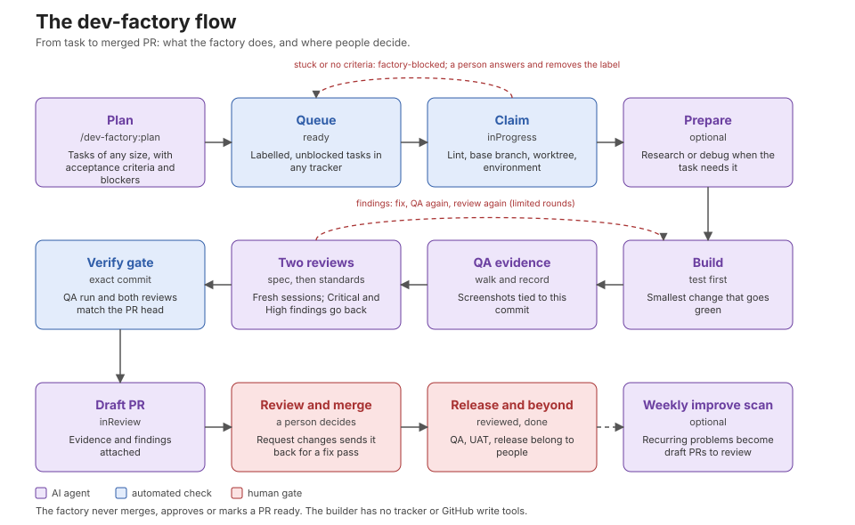

# dev-factory

A Claude Code plugin that plans, builds, verifies and ships work: it takes a task, builds it in an isolated git worktree, records QA evidence, has it reviewed in two steps by fresh-context agents, and opens a **draft pull request** for a person to review. Then it takes the next one.

The loop is the same whatever the size of the work, and whatever you track it in:

**plan → implement → evidence → review → ship → repeat**

It is kept in your repository. There is no database and no service: the task source holds task state, GitHub holds pull requests, git holds the code, and `.dev-factory/` inside each worktree holds run state. A person approves and merges every PR; the factory never does.

## Contents

[At a glance](#at-a-glance) · [Concepts](#concepts) · [Requirements](#requirements) · [Quick start](#quick-start) · [Where do tasks live?](#where-do-tasks-live) · [Writing a task](#writing-a-task-the-factory-can-build) · [Everything is optional](#everything-is-optional) · [How a task flows](#how-a-task-flows) · [Configuration](#configuration) · [Starting a session](#starting-a-session) · [Unattended passes](#set-up-for-unattended-passes) · [Using the factory](#using-the-factory) · [Environments](#environments) · [QA evidence](#qa-evidence) · [Rules](#rules-and-their-reasons) · [Layout](#layout) · [Troubleshooting](#troubleshooting) · [Known limits](#known-limits)

The flow at a glance: [docs/dev-factory-flow.svg](docs/dev-factory-flow.svg).

## At a glance

|           |                                                                                                                                                                               |
| --------- | ----------------------------------------------------------------------------------------------------------------------------------------------------------------------------- |
| **In**    | A task: an idea typed to `/dev-factory:quick`, a markdown file, a GitHub issue, a Notion page or a Jira issue, with acceptance criteria.                                      |
| **Out**   | A draft pull request on its own branch, with the tests that drove it, QA screenshots tied to the exact commit, two independent reviews, and a root-cause note for bugs.       |
| **Never** | Merges, approves, marks a PR ready, force-pushes, pushes any branch but the task's own, or writes to your task tracker from the builder. A person always decides what merges. |
| **Needs** | Claude Code, git, the GitHub CLI and Node 20. Docker only if your tests need a container; a tracker and MCP servers only if you want them.                                    |
| **Runs**  | In your own session (`/dev-factory:build`, `quick`, `plan`) or unattended every 15 minutes (`tick`), the same agents either way.                                              |

## Concepts

| Term                | Meaning                                                                                                                                                                                    |
| ------------------- | ------------------------------------------------------------------------------------------------------------------------------------------------------------------------------------------ |
| **Task**            | One demoable slice of work with acceptance criteria. Whatever your tracker calls it: a ticket, an issue, a page, a file. Its **key** looks like `TASK-3`, `GH-12` or `APP-123`.            |
| **Task source**     | Where tasks live: `local`, `github`, `notion` or `jira` (`tasks.source`). The factory speaks to all of them through the same operations: list, get, set state, comment, block, create.     |
| **State**           | Where a task is in the loop: `ready`, `inProgress`, `inReview`, `reviewed`, `done`. Each source maps these onto its own statuses or labels.                                                |
| **Factory label**   | `tasks.label` (default `dev-factory`). A task without it is invisible to the factory; adding it is how a person releases work.                                                             |
| **Blocked**         | The label `factory-blocked` on a task the factory gave up on, with a comment saying what decision it needs. A person answers and removes the label.                                        |
| **Worktree**        | A separate git checkout (`<worktrees>/<KEY>`) where one task is built, so your own checkout is never touched.                                                                              |
| **Environment**     | What the task is tested against: nothing special (`none`, tests run on the host) or an isolated docker compose project (`compose`).                                                        |
| **QA evidence**     | A recorded walk of each UI-facing criterion, with a screenshot taken at the exact commit being shipped. Only `qa.mjs` can mark a case as passed.                                           |
| **Two reviews**     | A **spec** reviewer (does it do what the task asks, nothing more) and a **standards** reviewer (rules, safety, tests), each in a fresh read-only session.                                  |
| **Gate**            | A check that must pass before work moves on: the readiness lint at claim, the verify gate before a PR moves to review, the stop gate that stops an agent ending without its hand-off file. |
| **Tick**            | One unattended pass: a scheduler runs `scripts/tick.sh`, which runs `claude -p /dev-factory:tick`. A cheap preflight decides whether a paid session starts at all.                         |
| **Inline**          | You run a command yourself in an interactive Claude Code session. Same work, visible, using your own login and permissions.                                                                |
| **Placeholder key** | `tasks.placeholderKey` (default `TASK-000`): the key `/dev-factory:quick` puts in branch names and PR titles when there is no task.                                                        |

## Requirements

| Needed                                                         | Why                                                              | Check                        |
| -------------------------------------------------------------- | ---------------------------------------------------------------- | ---------------------------- |
| Claude Code                                                    | runs the commands and agents                                     | `claude --version`           |
| git, and a GitHub remote                                       | worktrees, branches, PRs                                         | `git remote -v`              |
| GitHub CLI signed in                                           | opens PRs, reads reviews, and is the `github` task source        | `gh auth status`             |
| Node 20 or newer                                               | every script and the tests (`.nvmrc` is honoured when present)   | `node -v`                    |
| Docker (only for `environment.type: compose`)                  | an isolated stack per task                                       | `docker info`                |
| Xcode simulator and Maestro (only when `mobile.appDir` is set) | the device lane                                                  | `xcrun simctl list runtimes` |
| macOS (only for the launchd scheduler)                         | `dev-factory install` renders launchd jobs; the cloud needs none | `uname`                      |

`dev-factory doctor` checks all of this against your actual config and prints the fix for each failure.

## Quick start

Everything below runs from the root of the repository you want the factory to work on. The plugin is installed once per machine from its marketplace; nothing is copied into your repository.

**1. Install the plugin.**

```bash
claude plugin marketplace add Nightwolf001/agentic-dev-factory
claude plugin install dev-factory@dev-factory
```

(Inside a session: `/plugin marketplace add Nightwolf001/agentic-dev-factory`, then `/plugin install dev-factory@dev-factory`. On Claude Code 2.1.292 or newer one command does both: `claude plugin install dev-factory --marketplace Nightwolf001/agentic-dev-factory`.) The plugin declares `superpowers` as a dependency; if it is not installed, `dev-factory doctor` says so and gives the command (`claude plugin install superpowers@claude-plugins-official`). To try a clone without installing, start Claude with `claude --plugin-dir /path/to/agentic-dev-factory`.

Start `claude` in your repository. While the plugin is enabled, `dev-factory` is on the PATH of Claude's shell, and every `/dev-factory:` command is available.

**2. Set up once.** `/dev-factory:setup` looks at the repository, asks where tasks live, which MCP servers you want and whether tests need a container, and writes a small `dev-factory.config.json`. Every question has a working answer that needs no account. Prefer to do it by hand? Create the file yourself:

```json
{ "tasks": { "source": "github" } }
```

**3. Plan some work.**

```text
/dev-factory:plan "add CSV export to the reports page"
```

Claude interviews you one question at a time, sizes the work, drafts each task with acceptance criteria, shows you every description, and creates nothing until you approve. For `local` that writes files such as `.factory/tasks/TASK-1-add-csv-export.md`; for `github` it opens issues labelled `dev-factory`.

**4. Watch it build one task.**

```text
/dev-factory:build TASK-1
```

You see the worktree and branch being created, the test written first, the QA walk, both reviews, and a draft PR at the end. The task moves `ready` → `inProgress` → `inReview` as it goes.

**5. Review the PR like any other.** Request changes and the next pass fixes them on the same branch; approve and merge when you are happy.

**6. When you trust it, let it run.** On a Mac, `dev-factory install --apply --load` schedules `tick` every 15 minutes; in the cloud use GitHub Actions or a Claude Code routine (see [Unattended passes](#set-up-for-unattended-passes) and [Cloud and Claude environments](#cloud-and-claude-environments)).

No tracker at all and just a small change? Skip steps 3 and 4:

```text
/dev-factory:quick "make the arm banner text match the design"
```

`/dev-factory:status` is a safe first command at any point: it only reads.

## Where do tasks live?

`tasks.source` in the config chooses one. Every one maps onto the same five states (`ready`, `inProgress`, `inReview`, `reviewed`, `done`), so commands, agents and the scheduler behave the same.

| Source   | You need                                       | MCP server  | Good for                                                              |
| -------- | ---------------------------------------------- | ----------- | --------------------------------------------------------------------- |
| `local`  | nothing                                        | none        | Solo work, trying the factory, a plan that lives in the repository    |
| `github` | `gh auth login`                                | none        | Teams on GitHub: issues, labels, PRs in one place (recommended there) |
| `notion` | a Notion integration token for unattended runs | `notion`    | Teams that plan in Notion                                             |
| `jira`   | a Jira API token for unattended runs           | `atlassian` | Teams on Jira workflows                                               |

Details, status mappings and the exact operations are in [`skills/task-source/`](skills/task-source/SKILL.md). No tracker at all? `/dev-factory:quick` needs none.

### Setting up each source

Put the snippet in `dev-factory.config.json` at the repository root (or let `/dev-factory:setup` write it), then run `dev-factory config validate`.

**`local`** (the default): nothing to configure. Tasks are markdown files under `.factory/tasks/` (`sources.local.dir`), named `<KEY>-<slug>.md`, with a small frontmatter block (`key`, `title`, `state`, `type`, `labels`, `blockedBy`, `updated`) and the description below it. Commit the folder to share a plan, or leave it out of git for a private queue. A person can edit a file freely between passes: `state: ready` queues it, adding `factory-blocked` to `labels` parks it.

**`github`**: no MCP server and no extra token, only `gh auth login`.

```json
{ "tasks": { "source": "github" }, "sources": { "github": { "repo": "owner/name", "assignee": "@me" } } }
```

Run `dev-factory tasks init` once to create the labels. An open issue with the `dev-factory` label is `ready`; progress is a label (`df:in-progress`, `df:in-review`, `df:reviewed`); a closed issue is `done`. `repo` defaults to the current repository and `assignee` is optional (leave it out and any labelled issue qualifies). Keys are `GH-<issue number>`.

**`notion`**: a database with a title (`Name`), a `Status` property (status or select) whose options include the five states, a `Tags` multi-select, an optional `Type` select, a unique-ID property so every page has a key like `TASK-12`, and optionally a `Blocked by` relation to the same database. To show the work on the task itself, add `Branch` and `Pull request` (URL), `QA verdict` (select: pass, fail, not applicable) and `Evidence` (files); the factory fills them in when it opens the PR, and a gallery view with `Evidence` as the cover shows the screenshots. Property names are `sources.notion.properties`.

```json
{
	"tasks": { "source": "notion" },
	"sources": {
		"notion": {
			"databaseId": "<database id>",
			"states": { "ready": ["Ready"], "inProgress": "In progress", "inReview": "In review", "reviewed": "Reviewed", "done": ["Done"] }
		}
	}
}
```

Share the database with an internal integration and put its secret in `~/.dev-factory/.env.local` as `NOTION_TOKEN` (the scheduler's cheap preflight uses it), then `dev-factory mcp enable notion` and log in once with `/mcp` (the session's reads and writes use the Notion MCP server).

**`jira`**: set your site, cloud id, project keys and the status names of your workflow.

```json
{
	"tasks": { "source": "jira" },
	"sources": {
		"jira": {
			"site": "yourteam.atlassian.net",
			"cloudId": "<cloud id>",
			"projects": ["APP"],
			"requireSprint": true,
			"states": {
				"ready": ["Ready for Dev", "To Do"],
				"inProgress": "In Progress",
				"inReview": "Peer review",
				"reviewed": "Ready for QA",
				"done": ["UAT", "Done"]
			}
		}
	}
}
```

Put `JIRA_EMAIL` and `JIRA_API_TOKEN` in `.env.local` for the preflight, enable the MCP server with `dev-factory mcp enable atlassian`, and log in once with `/mcp`. Transitions are chosen by target status, never by name, because workflows differ per issue type. Ask a Jira admin to allow the labels the factory adds (`factory-blocked`, `factory-validated`, `factory-regression`, `needs-research`).

Switching source later changes only `tasks.source`; existing tasks stay where they are.

Dependencies are a `Blocked by: KEY, KEY` line in the description in every source (Jira and Notion also read native links), so a plan keeps its order everywhere.

### Plans of any size

`/dev-factory:plan` sizes the work first and tells you which it chose:

| Size         | Shape                                    | Output                                      |
| ------------ | ---------------------------------------- | ------------------------------------------- |
| Quick change | one small edit                           | no task: use `/dev-factory:quick`           |
| Single task  | one demoable slice                       | one task                                    |
| Feature      | several slices that depend on each other | a tracking task plus ordered slices         |
| Initiative   | several features or phases               | phase tasks; only the first phase is sliced |

Each task carries Summary, Acceptance criteria, Out of scope, Testing decisions and `Blocked by:`, checked by `qa.mjs ticket lint` before anything is created. The tracking task for a feature never gets the factory label, so the factory builds the slices, not the whole.

### Writing a task the factory can build

The factory builds what the description says and nothing more, so the description is the contract. `/dev-factory:plan` writes it for you; if you write one by hand, use these sections:

```markdown
## Summary

Reports can be exported as CSV from the reports page.

## Acceptance criteria

-   A "Download CSV" button appears above the reports table.
-   The file has one row per visible report with the same columns, in the same order.
-   An empty table downloads a file containing only the header row.

## Out of scope

-   Excel or PDF export.

## Testing decisions

The seam is `buildCsv(rows)` in `reports/export.ts`; the first red test asserts the header row for an empty list. Tests: `npm test`.

Blocked by: TASK-2
Base branch: feature/reports-v2
```

| Part                            | Required                               | What it does                                                                                                                                 |
| ------------------------------- | -------------------------------------- | -------------------------------------------------------------------------------------------------------------------------------------------- |
| Acceptance criteria             | always                                 | Concrete, checkable bullets. Checked at claim: a task without them is blocked with `needs acceptance criteria` rather than built on guesses. |
| Out of scope, Testing decisions | when planned with `plan` (strict lint) | Keeps the change small and names the first failing test.                                                                                     |
| `Blocked by:`                   | optional                               | Task keys (`TASK-2`, `GH-12`, `#12`). The task waits until every one is `done`. A `Blocked by` heading with a list works too.                |
| `Base branch:`                  | optional                               | Build on a pushed branch instead of the default; the PR targets it.                                                                          |
| `Research:`                     | optional                               | Questions for the researcher agent (also label the task `needs-research`).                                                                   |
| `Telemetry:`                    | optional                               | Sentry issue ids or log queries, plus `env:<name>`, for bug triage.                                                                          |

Check a draft yourself with `dev-factory qa ticket lint --file draft.md` (add `--strict true` for the planning standard).

## Everything is optional

The plugin registers **no MCP server**. `mcp/catalog.json` lists each one with what it is for and what you lose without it; a repository turns on the ones it wants.

```bash
dev-factory mcp list            # what exists, what is on
dev-factory mcp recommend       # suggestions for your task source
dev-factory mcp enable playwright context7
dev-factory mcp connect         # enable the recommended set, then show what still needs a login
dev-factory mcp connect --all   # every server in the catalog
```

Servers are written to the repository's own `.mcp.json` (merged, never overwriting yours). The scheduled pass builds its sandbox and permission settings from what is enabled, so a server that is off opens no network access.

A server you already have, at user scope or as a claude.ai connector, is used as it is: `enable` and `connect` skip it and say so rather than writing a second copy into `.mcp.json` (Claude warns about duplicates and runs both). `--force` adds it anyway. The scheduled pass is allowed to use those servers too. `dev-factory mcp doctor` (part of `dev-factory doctor`) reports each server in use and where it comes from, any that wait for your approval or a login, and a Playwright configured without `--isolated`, which makes QA walks share one browser profile; the fix is printed with it.

| Server                | What it adds                                  | Without it                                                           |
| --------------------- | --------------------------------------------- | -------------------------------------------------------------------- |
| `playwright`          | browser walks and screenshots for web QA      | a change that touches web UI is blocked for a person to check        |
| `maestro`             | mobile flows on a simulator                   | a change that touches the mobile app is blocked for a person         |
| `context7`            | current library docs                          | agents use the repository docs and `WebFetch`                        |
| `21st`                | UI component inspiration                      | UI work follows the repository's own components                      |
| `sequential-thinking` | structured reasoning                          | agents reason in their own context                                   |
| `notion`, `atlassian` | read and write Notion or Jira tasks           | choose another `tasks.source`                                        |
| `sentry`, `axiom`     | read-only telemetry for bug triage/validation | triage works from the task and a reproduction; validation is skipped |

OAuth servers need one login that no script can do for you: start `claude` and run `/mcp`. `connect` tells you which servers are waiting for it. `doctor.sh` reports which enabled servers are connected.

## How a task flows

1. A task is `ready`: labelled for the factory (`tasks.label`, default `dev-factory`), not parked with `factory-blocked`, and with every blocker `done` (or, with `tasks.unblockOnPr` on, every blocker `done` or in review with an open PR the task can [stack on](#stacked-prs)).
2. `/dev-factory:tick` checks the caps, then claims one by setting it `inProgress`. A source that refuses a stale change means two passes cannot claim the same task.
3. A worktree and branch (`<type>/<KEY>-<slug>`) are created, and `scripts/e2e-env.sh up` starts the environment, if the repository has one.
4. The `factory-builder` agent works test-first, then QA walks each case and records it with `bin/qa.mjs`.
5. Two fresh-context reviewers run in order: **spec** (does it do what the task asks, nothing more) and **standards** (does it follow the repository's rules and is it safe). Critical or High findings send the builder back; QA runs again and review restarts, at most `caps.maxFixRounds` times. Triggered `data`, `infra` and `security` steps follow.
6. The builder ships: pushes the branch, opens the draft PR with the evidence attached. The pass then records where the work is on the task (`LINK`): the branch and PR links, the QA verdict and the screenshots, as properties and files in Notion, remote links in Jira, a comment on a GitHub issue, or frontmatter and a copy of the images in the local task files. The pass re-verifies the QA manifest and both review records against the PR head, comments on the task, sets it `inReview`, and tears the environment down.
7. You review the PR. Two optional settings shape what comes next: `pr.reviewedOnMergeInto` / `pr.doneOnMergeInto` say which merge makes a task reviewed and which makes it done (for a develop-then-main flow, `"develop"` and `"main"`), and `review.bugbot` has Bugbot review each push and the factory fix what it finds. A comment starting `dev-factory fix` (no slash needed), followed by what to change, asks for a fix pass on any PR. A change request (not a plain comment) from someone other than the PR author sends the task back for a fix pass; an approval or merge sets it `reviewed`. After that, QA, release and anything else belong to people.

When the factory cannot continue it labels the task `factory-blocked`, comments the reason and the decision it needs, and returns it to `ready` (the label keeps it out of the queue). Answer in a comment and remove the label. If `caps.breakerThreshold` tasks were blocked within `caps.breakerWindowHours` the pass stops claiming until you look.



## Configuration

You change how the factory behaves with settings, not code. Every setting has a default that works with no file at all; you only write down what differs for your repository.

### How to change a setting

Settings are layered. Later layers win:

| Order | Layer                      | Where                                                                             | Use it for                                                                                     |
| ----- | -------------------------- | --------------------------------------------------------------------------------- | ---------------------------------------------------------------------------------------------- |
| 1     | **Plugin defaults**        | `config.json` inside the plugin                                                   | Nothing: don't edit it. An update replaces it.                                                 |
| 2     | **Your repository's file** | `dev-factory.config.json` at the repository root                                  | Everything that is true for this project and its team. Commit it.                              |
| 3     | **A different file**       | the path in `DF_CONFIG`                                                           | A per-machine file, or tests. Replaces layer 2.                                                |
| 4     | **Environment variable**   | the variables in the table below, in your shell or in `~/.dev-factory/.env.local` | A value that differs on one machine, such as a model, a budget or the tracker token's project. |

**Merge rules for layer 2.** Objects merge key by key, so `{"git": {"baseBranch": "develop"}}` changes one value and keeps the rest of `git`. Arrays and plain values replace the default whole: `pr.areaLabels` or `environment.setup` in your file is the complete list. `null` is a real value (`git.baseBranch: null` means "the repository's default branch").

```bash
dev-factory config get debug                  # what is in effect now, defaults and your file merged
dev-factory config get source.states.inProgress   # `source.` reads from the active task source
dev-factory config validate                   # lists every problem; also part of `dev-factory doctor`
```

`/dev-factory:setup` writes the file for you. Edits take effect on the next command or pass; a scheduled pass reads the file fresh each time, and a cloud run reads it from the checkout. A mistake is caught by `dev-factory config validate` before it can do harm (wrong source name, missing Jira site, a negative number, an invalid scrub pattern).

#### Variables that override a setting

| Setting                     | Variable                   |
| --------------------------- | -------------------------- |
| `caps.maxOpenPrs`           | `DF_MAX_OPEN_PRS`          |
| `caps.maxConcurrent`        | `DF_MAX_CONCURRENT`        |
| `caps.maxBudgetUsd`         | `DF_MAX_BUDGET_USD`        |
| `caps.maxResumes`           | `DF_MAX_RESUMES`           |
| `caps.frontierRepeatHours`  | `DF_FRONTIER_REPEAT_HOURS` |
| `tasks.source`              | `DF_TASK_SOURCE`           |
| `tasks.label`               | `DF_TASK_LABEL`            |
| `sources.github.repo`       | `DF_GITHUB_REPO`           |
| `sources.notion.databaseId` | `DF_NOTION_DATABASE_ID`    |
| `sources.notion.project`    | `DF_NOTION_PROJECT`        |
| `sources.jira.cloudId`      | `DF_JIRA_CLOUD_ID`         |
| `sources.jira.projects`     | `DF_JIRA_PROJECTS`         |
| `models.orchestrator`       | `DF_MODEL`                 |
| `models.builder`            | `DF_BUILDER_MODEL`         |
| `models.reviewer`           | `DF_REVIEWER_MODEL`        |
| `models.debugger`           | `DF_DEBUGGER_MODEL`        |
| `models.effort`             | `DF_EFFORT`                |
| `mobile.metroPort`          | `DF_METRO_PORT`            |
| `runtime.scheduler`         | `DF_SCHEDULER`             |
| `improvement.factoryRepo`   | `DF_FACTORY_REPO`          |
| `cleanup.takeover`          | `DF_TAKEOVER`              |
| `blocked.agentDecides`      | `DF_AGENT_DECIDES`         |

A list setting such as `DF_JIRA_PROJECTS` takes a comma-separated value. Other variables are not settings but switches for one run: `DF_RUNTIME`, `DF_REPO`, `DF_STATE_DIR`, `DF_LOG`, `DF_CONFIG`, `DF_PREFLIGHT=off`, `DF_READY_TIMEOUT`, `DF_PLUGIN_DIR`, `DF_MCP_FILE`.

#### Common changes

```json
{
	"debug": { "maxDebugRounds": 3, "debugMinutes": 30 },
	"caps": { "maxFixRounds": 3, "maxBudgetUsd": 60, "maxOpenPrs": 5 },
	"models": { "builder": "opus", "reviewer": "sonnet", "effort": "high" },
	"git": { "baseBranch": "develop", "branchTypes": { "bug": "hotfix", "story": "feature" } },
	"tasks": { "label": "ai-ready", "blockedLabel": "ai-parked" },
	"pr": {
		"areaLabels": [
			{ "path": "services/api", "label": "api" },
			{ "path": "clients/", "label": "frontend" }
		]
	},
	"review": { "specialistAxes": { "data": ["**/migrations/**"], "security": ["**/auth/**"] } },
	"environment": { "readyTimeout": 1800, "preCommit": "npx lint-staged" }
}
```

| You want                                   | Change                                                                                     |
| ------------------------------------------ | ------------------------------------------------------------------------------------------ |
| A bigger debug or fix budget               | `debug.maxDebugRounds`, `debug.debugMinutes`, `caps.maxFixRounds`, `caps.maxQaFixAttempts` |
| A different spend or concurrency limit     | `caps.maxBudgetUsd` (per scheduled session), `caps.maxOpenPrs`, `caps.maxConcurrent`       |
| A different model for one role             | `models.<role>`; raise or lower thinking with `models.effort` and `models.efforts`         |
| Another tracker, or other status names     | `tasks.source`, then `sources.<name>` (the `states` mapping carries your workflow)         |
| A different release label or parking label | `tasks.label`, `tasks.blockedLabel`                                                        |
| Build on another branch                    | `git.baseBranch`, or a `Base branch:` line in one task                                     |
| Different branch prefixes or PR labels     | `git.branchTypes`, `pr.sizeLabels`, `pr.areaLabels`, `pr.categoryByBranchType`             |
| Which paths need extra reviews             | `review.specialistAxes`                                                                    |
| Which paths need a browser or device walk  | `dev-factory.qa.yaml` (same shape as `qa/profiles.yaml`)                                   |
| A stack per task                           | `environment.*` (see [Environments](#environments))                                        |
| Agents may stop whatever blocks a run      | `cleanup.takeover` (see [Clean-up after every run](#clean-up-after-every-run))             |
| Where and how it is scheduled              | `runtime.scheduler`; `dev-factory scheduler on` and `off`                                  |

What config cannot change: the guards, the hooks, the stop gate, the base sandbox and permissions, and the rule that a person merges. Those live in the plugin's code on purpose, so a repository's file cannot loosen them. To change one, change the plugin itself (see [Improving the factory itself](#improving-the-factory-itself)).

### Complete reference

Every setting, with its default. `see config.json` means the default is a longer list or map.

#### Tasks

| Key                    | Default             | What it does                                                                                                                      |
| ---------------------- | ------------------- | --------------------------------------------------------------------------------------------------------------------------------- |
| `tasks.source`         | `"local"`           | Where tasks live: `local`, `github`, `notion` or `jira`.                                                                          |
| `tasks.label`          | `"dev-factory"`     | The label that marks a task as the factory's. A task without it is invisible to the factory.                                      |
| `tasks.blockedLabel`   | `"factory-blocked"` | The label the factory adds to park a task it cannot continue; a person removes it.                                                |
| `tasks.fixComment`     | `"dev-factory fix"` | A comment on the PR or task starting with this text (a leading `/` is optional) asks for a fix pass; the rest is the instruction. |
| `tasks.placeholderKey` | `"TASK-000"`        | The key `/dev-factory:quick` puts in branch names and PR titles when there is no task. Set it to one your CI accepts.             |
| `tasks.bugTypes`       | `["bug"]`           | Task types (case-insensitive) that count as bugs: triaged by the debugger first, and the stop gate wants a recorded root cause.   |
| `tasks.unblockOnPr`    | `false`             | `true`: a task whose blockers are in review with an open PR is built on the blocker's branch ([Stacked PRs](#stacked-prs)).       |

#### Task sources

| Key                          | Default            | What it does                                                                                                                        |
| ---------------------------- | ------------------ | ----------------------------------------------------------------------------------------------------------------------------------- |
| `sources.local.dir`          | `".factory/tasks"` | Folder of task files, relative to the repository.                                                                                   |
| `sources.local.keyPrefix`    | `"TASK"`           | Prefix of new local task keys (`TASK-3`).                                                                                           |
| `sources.local.states`       | `see config.json`  | Status words in the task files for each factory state.                                                                              |
| `sources.github.repo`        | `null`             | `owner/name` of the issues repository; `null` is the current repository.                                                            |
| `sources.github.assignee`    | `null`             | Only issues assigned to this user qualify (for example `@me`); `null` means any labelled issue.                                     |
| `sources.github.keyPrefix`   | `"GH"`             | Prefix of GitHub task keys (`GH-12`).                                                                                               |
| `sources.github.states`      | `see config.json`  | The labels that mean in progress, in review and reviewed; closed means done.                                                        |
| `sources.notion.databaseId`  | `null`             | The task database. Required for Notion.                                                                                             |
| `sources.notion.project`     | `null`             | `owner/name` of the repository. When set, only pages whose Project property is this are listed, and the factory writes it.          |
| `sources.notion.properties`  | `see config.json`  | The database's property names: title, status, labels, type, id, and the optional branch, pullRequest, evidence, qaVerdict, project. |
| `sources.notion.states`      | `see config.json`  | Status names for each factory state.                                                                                                |
| `sources.jira.site`          | `null`             | Your Jira host, for example `yourteam.atlassian.net`. Required for Jira.                                                            |
| `sources.jira.cloudId`       | `null`             | The Atlassian cloud id. Required for Jira.                                                                                          |
| `sources.jira.projects`      | `[]`               | Project keys to watch (upper case). Required for Jira.                                                                              |
| `sources.jira.requireSprint` | `false`            | `true` limits the queue to issues in an open sprint.                                                                                |
| `sources.jira.states`        | `see config.json`  | Your workflow's status names for each factory state; put every post-review status you want treated as finished in `done`.           |

#### Runtime

| Key                 | Default  | What it does                                                                          |
| ------------------- | -------- | ------------------------------------------------------------------------------------- |
| `runtime.mode`      | `"auto"` | `auto` detects local or cloud; `local` or `cloud` forces it.                          |
| `runtime.scheduler` | `"auto"` | What runs scheduled passes: `auto`, `launchd`, `github-actions`, `routine` or `none`. |

#### Git

| Key                    | Default           | What it does                                                                                                                                              |
| ---------------------- | ----------------- | --------------------------------------------------------------------------------------------------------------------------------------------------------- |
| `git.baseBranch`       | `null`            | Branch a run builds on and PRs target. `null` is the repository's default branch.                                                                         |
| `git.agentAttribution` | `false`           | `false`: commits and PRs are always the person's own (no Co-Authored-By, no author override, no "generated with" text). `true` switches those checks off. |
| `git.branchTypes`      | `see config.json` | Task type (lower case) to branch prefix. An unlisted type is `task`.                                                                                      |
| `git.worktreeRoot`     | `"../.worktrees"` | Folder worktrees are created in, relative to the repository. Set it somewhere writable in the cloud.                                                      |

#### Pull requests

| Key                       | Default                                        | What it does                                                                                                                |
| ------------------------- | ---------------------------------------------- | --------------------------------------------------------------------------------------------------------------------------- |
| `pr.reviewedOnMergeInto`  | `null`                                         | `null`: a merged or approved PR makes the task reviewed. A branch (`"develop"`): only a merge into it does.                 |
| `pr.doneOnMergeInto`      | `null`                                         | A branch (`"main"`): the task is done once its PR, or a release carrying it, reached that branch. `null`: a person does it. |
| `pr.sizeLabels`           | `{"small": 100, "medium": 500, "large": null}` | PR size label to its upper bound in changed lines (`null` is unbounded).                                                    |
| `pr.areaLabels`           | `[]`                                           | List of `{ "path": "services/api", "label": "api" }`: a PR touching the path gets the label. None by default.               |
| `pr.categoryByBranchType` | `see config.json`                              | Branch prefix to the category label on the PR.                                                                              |

#### Caps and budgets

| Key                        | Default | What it does                                                                                        |
| -------------------------- | ------- | --------------------------------------------------------------------------------------------------- |
| `caps.maxOpenPrs`          | `3`     | Factory PRs open at once; a pass stops claiming at this number.                                     |
| `caps.maxConcurrent`       | `1`     | Tasks built in one pass. Raise it only after checking your plan's usage limits.                     |
| `caps.breakerThreshold`    | `2`     | This many blocked tasks within the window stop new claims until a person looks.                     |
| `caps.breakerWindowHours`  | `6`     | The window for the breaker.                                                                         |
| `caps.stallMinutes`        | `90`    | An in-progress task quiet for this long with no driver is a stray and is resumed or blocked.        |
| `caps.maxFixRounds`        | `2`     | How many times Critical or High review findings go back to the builder.                             |
| `caps.maxBugbotRounds`     | `3`     | How many fix rounds Bugbot findings get before the task is blocked for a person.                    |
| `caps.maxQaFixAttempts`    | `5`     | Fix attempts after failed QA per task.                                                              |
| `caps.maxBudgetUsd`        | `40`    | Spend cap for one scheduled session.                                                                |
| `caps.maxResumes`          | `2`     | Resumes of an orphaned task before it is blocked.                                                   |
| `caps.maxDecisions`        | `1`     | Decisions an agent may make on one task (`blocked.agentDecides`) before it is blocked for a person. |
| `caps.frontierRepeatHours` | `6`     | Hours before an unchanged queue is looked at again by a paid session.                               |
| `caps.maxStackDepth`       | `3`     | PRs in one stack, the new one included; a task that would be deeper waits for a merge.              |

#### Blocked tasks

| Key                    | Default | What it does                                                                                                                                                                                                                                                                                            |
| ---------------------- | ------- | ------------------------------------------------------------------------------------------------------------------------------------------------------------------------------------------------------------------------------------------------------------------------------------------------------- |
| `blocked.agentDecides` | `false` | When a build stops on a question (a choice between options, an ambiguity in scope), a fresh-context agent settles it and the build continues, so one open question does not hold up every task that waits on it. Off, the task is labelled and waits for a person. See [Blocked tasks](#blocked-tasks). |

#### Models

| Key                   | Default           | What it does                                                                        |
| --------------------- | ----------------- | ----------------------------------------------------------------------------------- |
| `models.orchestrator` | `"sonnet"`        | Model of the scheduled pass.                                                        |
| `models.builder`      | `"sonnet"`        | Model of the builder agent.                                                         |
| `models.reviewer`     | `"sonnet"`        | Model of the reviewers.                                                             |
| `models.debugger`     | `"sonnet"`        | Model of the debugger.                                                              |
| `models.researcher`   | `"haiku"`         | Model of the researcher.                                                            |
| `models.improver`     | `"sonnet"`        | Model of the improver.                                                              |
| `models.effort`       | `"high"`          | Default effort level.                                                               |
| `models.efforts`      | `see config.json` | Effort per role (`debugger`, `researcher`, `improver`), overriding `models.effort`. |

#### Environment

| Key                        | Default                              | What it does                                                                                                                                           |
| -------------------------- | ------------------------------------ | ------------------------------------------------------------------------------------------------------------------------------------------------------ |
| `environment.type`         | `"none"`                             | `none` (tests run on the host) or `compose` (an isolated docker compose project per task).                                                             |
| `environment.composeFile`  | `".devcontainer/docker-compose.yml"` | The compose file, relative to the worktree (compose only).                                                                                             |
| `environment.service`      | `"app"`                              | The service the repository is mounted in; setup commands, checks and tests run here (compose only).                                                    |
| `environment.user`         | `null`                               | User to run commands as inside the service.                                                                                                            |
| `environment.setup`        | `[]`                                 | Commands run inside the service after `up` (empty when the container already installs and starts the app).                                             |
| `environment.processCheck` | `null`                               | A command inside the service that must exit 0 for the stack to count as healthy.                                                                       |
| `environment.readyTimeout` | `900`                                | Seconds to wait for a fresh stack. The first start installs dependencies, so raise it.                                                                 |
| `environment.pingUrl`      | `null`                               | A URL polled from inside the service until it answers.                                                                                                 |
| `environment.webBaseUrl`   | `null`                               | The address a browser walk opens (canonical-ports mode).                                                                                               |
| `environment.submodules`   | `[]`                                 | Submodule paths to populate in a fresh worktree from your main checkout.                                                                               |
| `environment.preCommit`    | `null`                               | A command run in the container before each commit, for repositories whose commit hook needs the container's tools; the builder then commits with `-n`. |

#### Clean-up and takeover

| Key                | Default | What it does                                                                                                                                                                                                                                                   |
| ------------------ | ------- | -------------------------------------------------------------------------------------------------------------------------------------------------------------------------------------------------------------------------------------------------------------- |
| `cleanup.takeover` | `false` | Lets a run stop, kill and quit whatever blocks it: processes and containers on the ports it needs, leftover Playwright and Maestro sessions, simulators. Off, a run tears down only what it started. Also `DF_TAKEOVER=1` for one run. Only the owner sets it. |
| `cleanup.ports`    | `[]`    | Extra host ports a takeover frees before a run (the compose file's published ports, `mobile.metroPort` and the port of `environment.webBaseUrl` are always included).                                                                                          |

#### Mobile lane

| Key                   | Default                                  | What it does                                                      |
| --------------------- | ---------------------------------------- | ----------------------------------------------------------------- |
| `mobile.appDir`       | `null`                                   | The mobile app folder. Setting it enables the device lane.        |
| `mobile.hints`        | `["mobile app", "iOS", "Android"]`       | Words in a task that mark it as a mobile task.                    |
| `mobile.metroPort`    | `8081`                                   | Port of the app's dev server.                                     |
| `mobile.prepare`      | `null`                                   | Command run in the app folder before anything else.               |
| `mobile.install`      | `"yarn install --frozen-lockfile"`       | Installs the app's dependencies when `node_modules` is missing.   |
| `mobile.pods`         | `"yarn pods"`                            | Installs native pods when `ios/Pods` is missing.                  |
| `mobile.start`        | `"yarn start --port {port}"`             | Starts the dev server; `{port}` is filled in.                     |
| `mobile.build`        | `"yarn ios --udid {udid} --port {port}"` | Builds and installs the app; `{port}` and `{udid}` are filled in. |
| `mobile.nativeInputs` | `see config.json`                        | Globs (relative to the app) whose change means a native rebuild.  |

#### Telemetry environments

| Key            | Default           | What it does                                                                                                                            |
| -------------- | ----------------- | --------------------------------------------------------------------------------------------------------------------------------------- |
| `environments` | `see config.json` | Per telemetry environment (`dev`, `staging`...): `sentry` (`org`, `environment`, `projects`) and `axiomDatasets` the debugger may read. |

#### Telemetry limits

| Key                       | Default | What it does                                                                 |
| ------------------------- | ------- | ---------------------------------------------------------------------------- |
| `telemetry.maxRows`       | `200`   | Largest result a telemetry query may ask for.                                |
| `telemetry.maxWindowDays` | `14`    | Longest time window a telemetry query may span.                              |
| `telemetry.scrubPatterns` | `[]`    | Extra regular expressions the scrub check refuses in comments and PR bodies. |

#### Debug budget

| Key                    | Default | What it does                                                          |
| ---------------------- | ------- | --------------------------------------------------------------------- |
| `debug.maxDebugRounds` | `2`     | Debugger rounds per task; a third is refused and the task is blocked. |
| `debug.debugMinutes`   | `20`    | Minutes one debug command may run.                                    |

#### Validation

| Key                             | Default | What it does                                     |
| ------------------------------- | ------- | ------------------------------------------------ |
| `validation.minHoursAfterMerge` | `24`    | Wait after a merge before post-merge validation. |

#### Self-improvement

| Key                                | Default                     | What it does                                                                                        |
| ---------------------------------- | --------------------------- | --------------------------------------------------------------------------------------------------- |
| `improvement.project`              | `null`                      | Project key or database for improvement tasks, when the task source needs one.                      |
| `improvement.factoryRepo`          | `null`                      | A local checkout of the plugin repository, so `/dev-factory:improve` can change the factory itself. |
| `improvement.label`                | `"dev-factory-improvement"` | Label of improvement tasks (never the factory label).                                               |
| `improvement.maxTicketsPerScan`    | `5`                         | New improvement tasks per scan.                                                                     |
| `improvement.maxPrsPerScan`        | `2`                         | Improvement PRs per scan.                                                                           |
| `improvement.minEvidence`          | `2`                         | Occurrences across different tasks before a finding counts.                                         |
| `improvement.maxPromotionsPerScan` | `3`                         | Learnings promoted into `AGENTS.md` per scan.                                                       |
| `improvement.agentsRuleCap`        | `15`                        | Learned rules allowed per `AGENTS.md` section.                                                      |

#### Review

| Key                     | Default           | What it does                                                                                                                                            |
| ----------------------- | ----------------- | ------------------------------------------------------------------------------------------------------------------------------------------------------- |
| `review.specialistAxes` | `see config.json` | Globs that trigger the extra `data`, `infra` and `security` review steps.                                                                               |
| `review.bugbot`         | `false`           | `true`: after every push the factory comments `review.bugbotComment`, watches Bugbot's review, fixes its findings and resolves the threads it answered. |
| `review.bugbotComment`  | `"bugbot run"`    | The comment that starts a Bugbot review.                                                                                                                |
| `review.bugbotAuthor`   | `"cursor[bot]"`   | The login Bugbot's review comments come from.                                                                                                           |

#### Sandbox

| Key                    | Default | What it does                                                                                |
| ---------------------- | ------- | ------------------------------------------------------------------------------------------- |
| `sandbox.enabled`      | `null`  | `true` or `false` overrides the base sandbox switch of the scheduled pass; `null` keeps it. |
| `sandbox.extraDomains` | `[]`    | Extra hosts the scheduled pass may reach.                                                   |

QA surface rules (which paths need a browser or device walk) are in `qa/profiles.yaml`; a repository replaces them with its own `dev-factory.qa.yaml` of the same shape.

### Blocked tasks

By default a build that hits a question it cannot answer (two ways to meet the criteria, a backend change the ticket does not cover) is labelled `factory-blocked`, and every task that waits on it waits too. With `blocked.agentDecides` on, the pass first sends the question to a read-only, fresh-context agent (the researcher agent, run on the builder's model). It reads the ticket's acceptance criteria and the code and answers with one of two lines:

-   `DECISION: <option> because <reason>`: it prefers the option that stays inside the ticket's stated scope, can be undone, and loses no safety; the option it passed over is recorded as a follow-up. The pass comments the decision on the task, commits the notes to `docs/plans/<KEY>/research.md`, and hands the decision to the builder as part of the acceptance criteria. The PR body lists it under "Decisions made without a person" so a reviewer can overrule it.
-   `ESCALATE: <reason>`: every option is destructive or irreversible, or involves credentials, production data, spend or a product or legal call only a person can make. The task is blocked as before, with the agent's reason added.

At most `caps.maxDecisions` decisions are made per task. Environment failures, spent budgets, stalls and a task with no acceptance criteria are never decided by an agent; they block as before.

## Starting a session

The `/dev-factory:...` commands exist only in a session that has the plugin enabled.

| Situation                              | Do this                                                                                                                                                                          |
| -------------------------------------- | -------------------------------------------------------------------------------------------------------------------------------------------------------------------------------- |
| Installed with `claude plugin install` | Run `claude` in any repository. It is on for every project of this user.                                                                                                         |
| One project, shared with the team      | `claude plugin install dev-factory@dev-factory --scope project` (or `dev-factory cloud init`): committed to `.claude/settings.json`, so teammates and cloud sessions get it too. |
| Trying a clone                         | `claude --plugin-dir /path/to/agentic-dev-factory`. The flag works only when Claude starts, and it wins over an installed copy.                                                  |
| Already inside a running session       | `/reload-plugins` after installing, or `/exit` and start `claude` again.                                                                                                         |

Update with `claude plugin update dev-factory@dev-factory`; scheduled jobs find the newest installed version by themselves.

`dev-factory` is on the PATH of Claude's own shell. To use it from your own terminal, run `/dev-factory:setup` once: it writes a small launcher to `~/.dev-factory/bin/dev-factory` that runs the newest installed copy (add that folder to your PATH).

## Set up for unattended passes

Only needed for scheduled passes. Everything else uses your normal login.

1. `dev-factory doctor` checks the machine and the config and says how to fix each failure. `dev-factory doctor --wizard` walks the manual steps.
2. `dev-factory install` shows what it would do; `--apply` writes the launcher, creates `~/.dev-factory/.env.local` (mode 600, outside every repository) and installs the plugins in `plugins.json`; `--load` also loads the scheduler.
3. **Unattended login**: in a normal terminal tab run `claude setup-token` and put the value in `~/.dev-factory/.env.local` as `CLAUDE_CODE_OAUTH_TOKEN`. The shell guard stops factory agents reading env files, and the file is read by `tick.sh` at run time.
4. **Task source tokens**, only for `jira` (`JIRA_EMAIL`, `JIRA_API_TOKEN`) and `notion` (`NOTION_TOKEN`). They let the scheduler's preflight check for work without starting a paid session. `local` and `github` need none.

Choose where the schedule runs with `runtime.scheduler` (default `auto`):

| Scheduler        | Runs on                     | Set up with                                                                                                              |
| ---------------- | --------------------------- | ------------------------------------------------------------------------------------------------------------------------ |
| `launchd`        | your Mac (auto on macOS)    | `dev-factory install --apply --load`; one job pair per repository, labelled `com.dev-factory.<repo>.tick` and `.improve` |
| `github-actions` | GitHub-hosted runners       | `dev-factory cloud init --github-actions`                                                                                |
| `routine`        | Claude's cloud              | `dev-factory cloud init --routine` prints the `/schedule` request to make                                                |
| `none`           | nowhere; you run it by hand | `dev-factory tick`                                                                                                       |

Switch the schedule on and off with one command, whichever scheduler you use:

```bash
dev-factory scheduler status            # which scheduler, running or stopped, pause switch
dev-factory scheduler off               # stop the scheduled passes (add tick or improve to stop one)
dev-factory scheduler on                # start them again
dev-factory tick                        # one pass by hand, in the current repository: not affected by the switch
```

In a Claude session the same thing is `/dev-factory:scheduler on|off|status`. `off` keeps the jobs and the configuration; `on` restores them. What each scheduler does:

| Scheduler        | `off`                                                            | `on`                                                            |
| ---------------- | ---------------------------------------------------------------- | --------------------------------------------------------------- |
| `launchd`        | unloads this repository's `tick` and `improve` jobs              | loads them (installing them first if they were never installed) |
| `github-actions` | `gh workflow disable dev-factory-tick.yml`                       | `gh workflow enable dev-factory-tick.yml`                       |
| `routine`        | sets the pause switch; pause the routine itself with `/schedule` | clears the pause switch; resume the routine with `/schedule`    |

`off` also sets a pause switch (`~/.dev-factory/paused.<repo>`) that scheduled passes read first, so a pass that was already queued does nothing; manual `dev-factory tick` runs ignore it.

A pass builds one task at a time by default, keeps at most `caps.maxOpenPrs` factory PRs open, and stops a session at `caps.maxBudgetUsd`.

## Cloud and Claude environments

The factory runs where there is no developer machine: Claude Code on the web, a GitHub Actions schedule, or a Claude Code routine. The runtime is detected (`CLAUDE_CODE_REMOTE` or `GITHUB_ACTIONS` means cloud); force it with `DF_RUNTIME` or `runtime.mode`.

```bash
dev-factory cloud init                    # commit the marketplace and enabled plugins into .claude/settings.json
dev-factory cloud init --github-actions   # also write .github/workflows/dev-factory-tick.yml
dev-factory cloud init --routine          # also print how to schedule /dev-factory:tick as a routine
```

`cloud init` merges into `.claude/settings.json` (your other settings are kept), so a fresh cloud session installs dev-factory and `superpowers` on start. Commit that file. What differs from a local run:

| Concern         | Local                                        | Cloud                                                                                                                                 |
| --------------- | -------------------------------------------- | ------------------------------------------------------------------------------------------------------------------------------------- |
| Login           | your login, or `CLAUDE_CODE_OAUTH_TOKEN`     | supplied by Claude Code on the web; a repository secret in GitHub Actions                                                             |
| Commit identity | your git identity                            | Claude Code on the web uses your account; in Actions set the repository variables `DF_GIT_NAME` and `DF_GIT_EMAIL`                    |
| GitHub access   | `gh auth login`                              | `GH_TOKEN`; in Actions a `DF_GH_TOKEN` secret of the person who should own the PRs (the default token cannot trigger other workflows) |
| Machine state   | `~/.dev-factory`                             | `DF_STATE_DIR` (a cached folder in Actions); logs go to `<state>/logs` instead of the macOS log folder                                |
| Worktrees       | `../.worktrees` beside the repository        | set `git.worktreeRoot` to a writable folder if the checkout's parent is read-only                                                     |
| Environment     | `none` or a docker compose project           | `none` unless the runner has Docker; there is no simulator, so no mobile lane                                                         |
| Sandbox         | `settings.factory.json` sandbox on           | set `sandbox.enabled` to `false` if the platform already sandboxes the session                                                        |
| Task source     | any                                          | `github`, `notion` or `jira`; `local` works only for task files that are committed and pushed                                         |
| MCP servers     | `dev-factory mcp connect`, then `/mcp` login | commit `.mcp.json`; OAuth servers need a login the cloud session cannot do, so prefer API-token or no-MCP sources                     |

The GitHub Actions workflow runs one pass every 15 minutes under a `concurrency` group so two passes never overlap, restores the factory's state between runs from the Actions cache, sets the commit identity from the repository variables, installs the plugin from the marketplace, and runs `dev-factory tick`. Its header lists the secrets it needs.

## Using the factory

| You want to                       | Do                                                                                                        |
| --------------------------------- | --------------------------------------------------------------------------------------------------------- |
| Set it up                         | `/dev-factory:setup`                                                                                      |
| Plan work of any size             | `/dev-factory:plan "<idea>"`                                                                              |
| Build one task, watching          | `/dev-factory:build TASK-12 [--base <branch>]`                                                            |
| Make a small change, no task      | `/dev-factory:quick "<change>"`                                                                           |
| Fix review feedback on an open PR | `/dev-factory:quick --pr 1234 ["<extra instruction>"]`                                                    |
| See what is going on              | `/dev-factory:status`                                                                                     |
| Check the machine and config      | `/dev-factory:doctor`                                                                                     |
| Check a fix after the merge       | `/dev-factory:validate TASK-12` (needs a telemetry MCP server)                                            |
| Run one scheduled pass            | `dev-factory tick` or `/dev-factory:tick`                                                                 |
| Switch the schedule on or off     | `/dev-factory:scheduler on\|off\|status` or `dev-factory scheduler on\|off\|status`                       |
| Ask for changes                   | Submit a **Request changes** review on the PR, or comment `/dev-factory fix <what to change>` on the task |
| Unblock                           | Answer the factory's comment, then remove the `factory-blocked` label                                     |
| Keep a task out of the queue      | Remove `tasks.label` or add `factory-blocked`                                                             |

### Tick or inline?

|             | Tick (unattended)                                                                                            | Inline (your session)                                 |
| ----------- | ------------------------------------------------------------------------------------------------------------ | ----------------------------------------------------- |
| Started by  | a scheduler every 15 minutes, or `dev-factory tick`                                                          | you typing a command                                  |
| Which tasks | every `ready` task in queue order, up to the caps                                                            | the one you name (`build`), or none (`quick`)         |
| Permissions | `settings.factory.json` plus what you enabled; sandboxed, no prompts, a budget cap                           | your own                                              |
| Login       | `CLAUDE_CODE_OAUTH_TOKEN` from `claude setup-token`                                                          | your normal login                                     |
| Idle cost   | none: a script checks the task source first and starts nothing when there is no work                         | not applicable                                        |
| Also does   | resumes orphaned tasks, advances `inReview` tasks after approval, validates merged bugs, weekly improve scan | fixes review feedback on a PR you name (`quick --pr`) |

Both dispatch the same agents with the same guards.

### Choosing the base branch

Every run builds on a branch and opens its PR into it. The base is the first of: `--base <branch>`, a `Base branch: <branch>` line in the task, `git.baseBranch`, the repository's default branch. The worktree is cut from `origin/<base>`. A base must be on `origin` and your local copy must not be ahead of it, because the factory never pushes a base branch. When a base cannot be used it says why and stops (a scheduled pass blocks the task).

### Stacked PRs

Off by default (`tasks.unblockOnPr`). Without it a task waits in `ready` until every blocker is merged and `done`, which means a person merges each PR by hand before the next can start. With it on, a task whose blockers are not `done` but are in `inReview` (or `reviewed`) with an open PR on `origin` is built on the blocker's branch, and its draft PR targets that branch.

**Which tasks stack.** Every blocker must be `done`, or in review with an open PR whose branch is on `origin` (a fork's branch is not). A blocker still `ready` or `inProgress`, with no PR, or whose PR is closed keeps the task in `ready`. The task must also depend on the blocker's code: its description has a `Blocked by:` line naming the blocker, or mentions a file the blocker's PR changes. A blocker that only orders the work (a native link, nothing shared) does not stack. A `Base branch:` line naming the blocker's branch is an explicit choice and skips that check.

**Which base.** No unmerged blocker: `git.baseBranch` as before. One: that blocker's branch. Several: the one whose branch contains the others (a chain: `B` is stacked on `A`, the task is blocked by both, so it stacks on `B`). Blockers that are independent siblings: the task waits (it is skipped, not blocked) until one of them merges and the rest form a chain with it. This is a decision for the people who run the factory, taken as the safe default, and the alternative is open: building on a temporary integration branch that merges the siblings, which this version does not do because it would be a branch no person reviewed. A stack is at most `caps.maxStackDepth` PRs deep, the new PR included, and every stacked PR counts against `caps.maxOpenPrs`.

**What the run does.** The worktree is cut from `origin/<blocker branch>`, `run.json` records `base` as that branch (so `bin/qa.mjs` measures the diff, review and the size label against it and only the task's own commits are judged) and a `stack` entry with the blocker's PR. The draft PR targets the blocker's branch and its body starts with `This PR is stacked on PR #N (branch ...)`. That line is how later passes find the stack.

**When the blocker moves.** A pass checks every stacked PR's blocker first:

| The blocker's PR | The pass                                                                                                                           |
| ---------------- | ---------------------------------------------------------------------------------------------------------------------------------- |
| has new commits  | merges them into the dependent branch (`scripts/stack.mjs sync`), then QA and review run again before building on                  |
| merged           | points the PR at the branch the blocker merged into (`gh pr edit --base`) and merges that branch in (`scripts/stack.mjs retarget`) |
| closed unmerged  | blocks the dependent with the reason `blocker PR #N closed unmerged`                                                               |

The update is a merge, not a rebase. After a squash merge the blocker's original commits are gone from the target, but the squashed commit holds the same changes, so merging the target into the dependent applies cleanly and the PR diff shrinks to the dependent's own commits. `git rebase --onto` would give the same result but needs a force-push, which the factory never does. A conflict is never resolved by the factory: the merge is aborted and the task is blocked with the file names.

**Reviewed and done stay tied to a real merge.** A stacked PR that is merged into its blocker's branch is not `reviewed` and not `done`, whatever `pr.reviewedOnMergeInto` is: nothing has reached the base yet. Once the PR is retargeted, or a merge of it reaches `pr.doneOnMergeInto`, the usual rules apply. When both are unset, a person moves a task whose PR was merged into a blocker's branch.

Open design questions: independent sibling blockers (above); whether a long-lived stack should ever be merged bottom-up by the factory (it does not: a person merges); and a stack whose middle PR is closed (its dependents block, and a person rewires them).

### `/dev-factory:quick`

Runs the whole flow (worktree, environment, test-first build, QA walk, two reviews) for work with no task. A description starts a new change on `<type>/<tasks.placeholderKey>-<slug>`; `--pr <number>` fixes the open review threads and change requests of an existing PR and pushes to its branch (it asks first when the PR is someone else's). It never posts, resolves threads, marks ready or merges; at the end it offers one summary comment, scrubbed first. A change too big for one slice is sent to `/dev-factory:plan`.

## Preparation, debugging and the preflight

-   At claim the pass runs `qa.mjs ticket lint` on the description. A task with no acceptance criteria is blocked with `needs acceptance criteria` instead of being built on guesses.
-   A task labelled `needs-research`, or with a `Research:` block, first goes to `factory-researcher` (read-only, at most 3 hops), which writes `docs/plans/<KEY>/research.md`.
-   A bug, or a task linking a Sentry issue or a log query, first goes to `factory-debugger` (triage): it reproduces, finds the root cause and records it with `qa.mjs debug`. The builder starts from that record, and the stop gate refuses `build.done` on a bug without one. When the builder exhausts its fix budget the debugger runs again (unstick) with fresh context; a repeated fingerprint or a spent budget blocks the task. Telemetry is used when its MCP server is enabled and is read-only (see [Telemetry](#telemetry-read-only)).
-   A session killed mid-build leaves a task `inProgress`. The pass resumes any labelled task quiet for `caps.stallMinutes`, at most `caps.maxResumes` times, then blocks it.
-   `tick.sh` first runs `scripts/frontier.mjs check`, which asks the task source from a script whether a paid session has anything to do: a claimable task, an orphaned one, or an `inReview` PR that is approved, merged or has a fresh change request. Exit 20 logs "nothing to do". A missing token or a tracker or `gh` failure logs why and starts nothing. `DF_PREFLIGHT=off` skips the check. An unchanged frontier is not dispatched again for `caps.frontierRepeatHours`.

## Environments

`environment.type` decides what `scripts/e2e-env.sh` does:

-   **`none`** (default): there is no environment to start. Tests run on the host with the repository's own commands; `up` only records that.
-   **`compose`**: an isolated docker compose project named `df-<key>`. It builds and starts `environment.composeFile`, runs each `environment.setup` command inside `environment.service` (as `environment.user` if set), populates `environment.submodules` from your main checkout, and then `verify` checks that services are healthy, `environment.processCheck` exits 0 and `environment.pingUrl` answers from inside the service.

| Command                                                  | What it does                                                                                                     |
| -------------------------------------------------------- | ---------------------------------------------------------------------------------------------------------------- |
| `e2e-env.sh up --key KEY [--ports canonical] [--device]` | Start and verify. Exit 75 means a cap or the ports lock refused it; a later pass retries.                        |
| `e2e-env.sh verify`                                      | Re-check the contract.                                                                                           |
| `e2e-env.sh down`                                        | Remove the project and its volumes.                                                                              |
| `e2e-env.sh sweep`                                       | Remove `df-*` projects with no live owner, except one whose worktree changed in the last 3 hours. Safe any time. |

Isolated mode (`--ports none`) publishes no host ports so several worktrees can coexist, but a host browser cannot reach it; web QA needs `--ports canonical`, which the pass uses whenever `caps.maxConcurrent` is 1 and which takes a machine-wide lock (`environment.webBaseUrl` is recorded in `env.json`). `--device` implies canonical ports and, when `mobile.appDir` is set, boots a simulator and starts the app's dev server (`scripts/mobile-env.sh`). Run state lives in `.dev-factory/` inside each worktree (gitignored); machine state in `~/.dev-factory/`.

A canonical-ports start first checks that the compose file's published host ports are free and refuses with exit 75 and the port numbers (and the process holding them, when `lsof` can tell) before building anything, so your own copy of the stack running on the same ports is reported in seconds rather than after a long build. Other settings: `environment.readyTimeout` (seconds to wait for a fresh stack, default 900; the first start installs dependencies, so raise it, or set `DF_READY_TIMEOUT`), and `environment.preCommit` (a command to run inside the container before each commit, for repositories whose commit hook needs the container's tools: the builder runs it, then commits with `git commit -n`; unset means commit normally and let the hooks run). The isolated environments need Docker Compose 2.24 or newer; `dev-factory doctor` checks.

### Clean-up after every run

A finished run leaves nothing running, whatever its outcome (shipped, blocked or abandoned). The scheduled pass, `/dev-factory:build` and `/dev-factory:quick` end with `dev-factory cleanup --worktree <worktree>`, which:

-   runs `e2e-env.sh down` for the ticket's stack and `mobile-env.sh down` for its dev server;
-   shuts the simulator down again when the run booted it (a simulator you already had open stays open);
-   closes leftover Playwright browsers and Maestro sessions (never the MCP servers themselves);
-   removes the machine-wide ports lock when its owner is gone, and sweeps `df-*` projects with no live owner.

It prints JSON: `done` lists what it stopped, `left` lists what it found and did not touch, with the reason. By default it touches only what the run started.

Set `cleanup.takeover` to `true` (or export `DF_TAKEOVER=1` for one run) when the machine is dedicated to the factory and you want a run to clear its own way: before a canonical-ports start it stops whatever process or container holds the stack's ports (instead of refusing with exit 75), and at the end it also stops those holding `cleanup.ports`, the dev server's port and any browser or Maestro session. The sandbox then lets `kill`, `pkill`, `killall`, `lsof`, `ps` and `pgrep` run, and the guard lets a builder use them and `docker stop`/`rm`/`kill` and `xcrun simctl shutdown` directly.

Takeover never reaches the shell, Claude, the terminal, launchd, window-server or other system processes, the parent of the run, `kill` of pid 0, 1 or -1, `docker prune`, mass `docker stop $(docker ps -q)` forms, `simctl erase` or `delete`, or the factory's own scheduler job. Agents cannot switch it on: `--takeover`, `DF_TAKEOVER` and edits to `dev-factory.config.json` are refused inside a run, so the toggle is only ever the owner's. `dev-factory doctor` warns while it is on.

## QA evidence

`dev-factory qa` is the only thing that can mark a case as passed.

| Command                                                                             | Purpose                                                    |
| ----------------------------------------------------------------------------------- | ---------------------------------------------------------- |
| `start --key KEY --profile web\|mobile`                                             | Bind a run to the current commit; refuses a dirty tree     |
| `record --run N --case SLUG --status pass\|fail --assertion TEXT --screenshot FILE` | Record one walked case                                     |
| `done --run N`                                                                      | Close the run and compute the verdict                      |
| `mark-na --key KEY --profile P --reason TEXT`                                       | Declare no UI surface changed, verified against the diff   |
| `review record --axis spec\|standards --head SHA --summary TEXT --findings JSON`    | Record one review step; step 2 needs a clean step 1        |
| `review status [--head SHA]`                                                        | Show the steps and whether the commit is clean             |
| `verify --head SHA --run N [--require-review true]` (or `--key KEY`)                | Confirm a passing result for exactly this commit           |
| `ticket lint\|base\|blocked-by --file F`                                            | Check a task description, read its base branch or blockers |

Cases are committed with the change, in your repository under `.factory/qa/cases/<KEY>/` (`.spec.ts` for Playwright, `.yaml` for Maestro). Which paths count as UI is `uiGlobs` in the QA profiles; `nonUiGlobs` carves documentation and tests out, so a diff that only touches Markdown is "no UI surface" and `mark-na` accepts it, while a code file beside it needs a walk. A pass needs a fresh screenshot of this run at this commit with an assertion that describes this walk.

## Rules and their reasons

-   The debugger and researcher cannot edit code; the improver cannot edit what enforces the factory's own limits.
-   The builder has no task-tracker or GitHub write tools. The scheduled pass is the only holder of them, so a task cannot approve itself.
-   Commits and PRs are always the person's own. While `git.agentAttribution` is `false` (the default) the shell guard refuses `Co-Authored-By`, `--author`, identity set through `git config` or `GIT_AUTHOR_*`, and "generated with" text in a commit or PR; `qa.mjs verify` refuses a branch with an agent as author, committer or co-author; the scheduled pass runs with Claude Code's own commit and PR attribution switched off. In your own interactive sessions set `"attribution": {"commit": "", "pr": ""}` in your Claude Code settings so Claude Code adds none either.
-   Only the task's own branch may be pushed, never forced. The shell guard reads git past global options, wrappers and `sh -c` or `$(...)` payloads, and treats `gh api` with a body field as a write.
-   When the environment is a container, dependencies are installed and tests run inside it, never on the host.
-   Inside a run, the installed plugin (and a vendored `dev-factory/`), `.claude/`, `.github/`, the local task files in `.factory/tasks/`, other tasks' QA cases, run state, and QA and review records cannot be edited by a task, by tool or by shell. Review records can only be written by `qa.mjs review record`, which refuses anyone whose `run.json` role is not that axis's reviewer; debug rounds likewise need the debugger role.
-   The factory agents cannot write the task tracker (`gh issue` writes and `tasks.mjs` writes are refused to them); only the scheduler pass and your own commands do.
-   Edits under a vendored `dev-factory/` are always checked against the vocabulary lint.
-   Nothing is retried on its own after a block. A person decides.

## Telemetry (read-only)

Sentry and Axiom are optional and reachable only by the debugger role. Rules are enforced by `scripts/mcp-guard.mjs` (PreToolUse), not by instruction: tools whose name is a write verb are denied, an Axiom query naming a dataset outside `environments.*.axiomDatasets` is denied, and `limit`, `take` and time windows above `telemetry.maxRows` and `telemetry.maxWindowDays` are denied. The guard matches the server whether the plugin or your `.mcp.json` started it. Nothing raw is written to files, PR bodies or task comments: `qa.mjs scrub --file F` fails on emails, phone numbers, JWTs, bearer tokens, long hex identifiers and `telemetry.scrubPatterns`.

## Self-improvement

-   Every pass appends a record to `~/.dev-factory/runs/runs.jsonl` and a counts-only comment on the task.
-   Learnings live in the PR body, never as repository files: at most 3 per task, each with a `scope:` path, mandatory after a debug round or a Critical or High finding (`qa.mjs learnings check`). Before a build the pass gives the builder up to five recent learnings that match the task's paths.
-   Promotion: a learning that recurred on two tasks, or that you confirm with `/dev-factory promote` on its PR, becomes one rule line in the `## Learned rules` section of the closest `AGENTS.md` through a draft PR. `CLAUDE.md` and editor rule files stay human-edited.
-   `/dev-factory:improve` (weekly through `improve.sh`, or by hand) clusters recurring causes, files at most `improvement.maxTicketsPerScan` improvement tasks, and opens at most `improvement.maxPrsPerScan` draft PRs for findings through `factory-improver`, each reviewed by the two-step review first. `IMPROVEMENT-PLAN.md` is the prioritised list. Nothing is merged without you. Changing the factory needs a checkout of its source: see [Improving the factory itself](#improving-the-factory-itself).

### Improving the factory itself

This section is for the owner of the plugin. The factory is installed from the marketplace into Claude's plugin cache, which an improvement never touches, so improvement PRs are made in a checkout of the plugin's own repository. `dev-factory target` (`scripts/factory-target.mjs`, which `/dev-factory:improve` runs first) finds one:

| Mode       | When                                                                                                                                    | Where the improver works                             |
| ---------- | --------------------------------------------------------------------------------------------------------------------------------------- | ---------------------------------------------------- |
| `self`     | you run `/dev-factory:improve` from inside the plugin's own repository (with `claude --plugin-dir .`)                                   | a worktree of that repository                        |
| `clone`    | `improvement.factoryRepo` (or `DF_FACTORY_REPO`) names a local checkout of the plugin repository, and you run the scan from any project | a worktree of that checkout, PRs go to its `origin`  |
| `vendored` | the plugin is copied into the repository at `dev-factory/`                                                                              | `dev-factory/` in a worktree of that repository      |
| `none`     | the plugin is only installed and no checkout is named                                                                                   | no PRs: findings are filed as improvement tasks only |

#### Two copies, two jobs

As the owner you have the plugin on your machine twice, on purpose:

| Copy                 | Where                                                                               | What it is for                                                                                                 |
| -------------------- | ----------------------------------------------------------------------------------- | -------------------------------------------------------------------------------------------------------------- |
| **Installed plugin** | Claude's plugin cache, `~/.claude/plugins/cache/dev-factory/dev-factory/<version>/` | What runs for every project. Read-only: nothing edits it. It changes only when you run `claude plugin update`. |
| **Source checkout**  | a folder you choose, for example `~/code/agentic-dev-factory` (`DF_FACTORY_REPO`)   | Where improvements are made and where your own edits go. A normal git clone of the plugin repository.          |

#### Set it up once

1. **Install the plugin** (the same two commands as the [Quick start](#quick-start)): `claude plugin marketplace add <you>/agentic-dev-factory`, then `claude plugin install dev-factory@dev-factory`.
2. **Clone the source** anywhere you like: `git clone git@github.com:<you>/agentic-dev-factory.git ~/code/agentic-dev-factory`.
3. **Point the factory at the clone**, permanently. Add this line to your shell profile and open a new terminal:
    ```bash
    echo 'export DF_FACTORY_REPO=~/code/agentic-dev-factory' >> ~/.zshrc
    ```
    Or, for one project, set it in that project's `dev-factory.config.json` (`~` is expanded): `{ "improvement": { "factoryRepo": "~/code/agentic-dev-factory" } }`. Claude started from a terminal inherits the variable; if you open Claude from the Dock or an app launcher it may not read your shell profile, so use the config setting instead.
4. **Check it** from inside any project: `dev-factory target` should print `{"mode":"clone","repo":"/Users/you/code/agentic-dev-factory","prefix":""}`. `"mode":"none"` means it cannot find the checkout; the `reason` says why.
5. **Keep the clone current** and clean. Before a scan, run `git -C ~/code/agentic-dev-factory pull --ff-only`. Leave it on `main` with no uncommitted changes, because the improver builds on `origin/main` through its own worktree and never touches your working files.

The evidence comes from the machine you run it on: every pass appends a record to `~/.dev-factory/runs/`, whichever repository it ran in, so a scan on your own machine sees patterns across all your projects. (Runs in GitHub Actions or a cloud session are not on your machine.)

#### How a scan works

1. From any project that uses the factory, run `/dev-factory:improve` (or let the weekly job run it). It runs `dev-factory target` first to find your checkout.
2. It clusters recurring causes from the run records, and files an improvement task for each in **that project's** task source (so the project's tracker shows the factory's own backlog).
3. For each finding that qualifies, up to `improvement.maxPrsPerScan`, it fetches your clone and adds a worktree of it (under `git.worktreeRoot`, beside the project, not inside your clone) on a new `ai-tooling/<KEY>-<slug>` branch cut from the clone's default branch.
4. The `factory-improver` agent writes the failing test first and then the change, and runs the tests, Prettier, the vocabulary lint and `claude plugin validate` on that worktree. Two fresh reviewers then check the commit.
5. It opens a **draft PR on the plugin's own repository** (the clone's `origin`). It never merges, and it never touches the installed copy or your clone's working tree.

#### After you merge an improvement

Installed copies update only when the plugin's version changes, so a merge alone reaches nobody:

1. Review the draft PR and merge it into `main`.
2. Bump `version` in `.claude-plugin/plugin.json` and in the marketplace entry in `.claude-plugin/marketplace.json` to the same new number (a test checks they agree), and merge that.
3. On each machine: `claude plugin marketplace update dev-factory`, then `claude plugin update dev-factory@dev-factory`, then restart Claude or run `/reload-plugins`. Scheduled jobs pick up the new version by themselves, because they run the launcher, which finds the newest installed copy.
4. Pull your clone: `git -C ~/code/agentic-dev-factory pull --ff-only`.

#### Working on the plugin by hand

Open Claude inside the clone with the clone itself loaded as the plugin: `cd ~/code/agentic-dev-factory && claude --plugin-dir .`. That copy takes precedence over the installed one for the session, so you can try a change before releasing it. Running `/dev-factory:improve` there is mode `self`.

The improver cannot edit what enforces the factory's own limits (the guards, the stop gate, `qa.mjs`, hooks, base settings, `config.json`, `plugins.json`) or `.github/` and `.claude/`; a finding there stays an improvement task for you. Someone who only installs the plugin gets mode `none` and can still file improvement tasks and promote learnings into their own `AGENTS.md`.

## Layout

| Path                           | Purpose                                                                                               |
| ------------------------------ | ----------------------------------------------------------------------------------------------------- |
| `commands/`                    | `setup`, `plan`, `build`, `quick`, `tick`, `scheduler`, `status`, `validate`, `improve`, `doctor`     |
| `agents/`                      | `factory-builder`, `-reviewer`, `-debugger`, `-researcher`, `-improver`, `-promoter`                  |
| `skills/`                      | `task-source`, `implement`, `qa`, `review`, `ship`, `environment`, `diagnose`, `telemetry`, `improve` |
| `scripts/sources/`             | One file per task source (`local`, `github`, `jira`, `notion`) and their shared model                 |
| `scripts/tasks.mjs`            | List, read, create and move tasks for the sources a script can drive                                  |
| `scripts/stack.mjs`            | Stacked PRs: plan a base, write the PR note, merge a moved blocker (rules in `stack-lib.mjs`)         |
| `scripts/mcp.mjs`, `mcp/`      | The optional MCP catalog and the commands that enable it                                              |
| `scripts/factory-settings.mjs` | Builds the scheduled pass's sandbox and permissions from what is enabled                              |
| `hooks/hooks.json`             | Shell guard, edit guard, telemetry guard and stop gate; active only inside a factory run              |
| `plugins.json`                 | Plugins the factory relies on and the one it disables                                                 |
| `scripts/`                     | `e2e-env.sh`, `mobile-env.sh`, `cleanup.mjs`, `tick.sh`, `install.sh`, `doctor.sh`, hook scripts      |
| `bin/qa.mjs`                   | QA, review, debug, scrub, ticket and learnings CLI                                                    |
| `qa/profiles.yaml`             | Default web and mobile QA profiles                                                                    |
| `config.json`                  | Defaults; the repository's `dev-factory.config.json` merges over them                                 |
| `settings.factory.json`        | Base sandbox and permission settings for scheduled runs                                               |
| `launchd/`                     | Scheduler templates rendered by `install.sh`                                                          |
| `test/`                        | `node --test test/*.test.mjs` (from the plugin repository root)                                       |

Developing the plugin: `claude --plugin-dir .` from this repository, `node --test test/*.test.mjs`, `claude plugin validate .`, `npx prettier@3.2.5 --check "**/*.{md,json,mjs}"`, `bash scripts/lint-vocabulary.sh`. Release by bumping `version` in `.claude-plugin/plugin.json` and the marketplace entry together (a test checks they agree); installed copies update with `claude plugin update`.

Adding a tracker: a new file under `scripts/sources/` that answers `list({ states, staleMinutes })` (and the write methods if scripts can drive it), a case in `scripts/sources/index.mjs`, a block under `sources` in `config.json` with its `states`, and `skills/task-source/<name>.md`. Adding an MCP server: an entry in `mcp/catalog.json`.

## Troubleshooting

| Symptom                                             | What to do                                                                                                                                                                                                                   |
| --------------------------------------------------- | ---------------------------------------------------------------------------------------------------------------------------------------------------------------------------------------------------------------------------- |
| `config: missing sources.jira.site`                 | `tasks.source` is `jira` but the Jira block is not filled in your `dev-factory.config.json`. Run `/dev-factory:setup`.                                                                                                       |
| `dev-factory: command not found`                    | It is on PATH only inside Claude's shell. In your terminal run `/dev-factory:setup` once and add `~/.dev-factory/bin` to PATH, or call the launcher by its full path.                                                        |
| `dev-factory plugin not found` from the launcher    | The plugin is not installed on this machine: `claude plugin install dev-factory@dev-factory`, or set `DF_PLUGIN_DIR` to a clone.                                                                                             |
| A scheduled job stopped after a plugin update       | It will not: jobs run the launcher, which picks the newest installed version. Check `~/.dev-factory/logs` or the macOS log and `dev-factory doctor`.                                                                         |
| `git worktree add` fails in the cloud               | The checkout's parent folder is read-only. Set `git.worktreeRoot` to a writable folder.                                                                                                                                      |
| Pass exits 75 immediately                           | Another pass holds `~/.dev-factory/tick.lock`. If none is running, delete the directory.                                                                                                                                     |
| `environment busy, retrying next pass`              | The device lock or the stack cap is held. `dev-factory env sweep` clears stale owners.                                                                                                                                       |
| `verify FAILED`                                     | A service or check did not pass. Read the message, then `docker compose -p df-<key> logs`.                                                                                                                                   |
| Port held by another process                        | Something else is running the dev server. Stop it yourself; the factory never kills a process it did not start.                                                                                                              |
| Builder says a tool is not allowed                  | MCP tools are named `mcp__<server>__*` when your `.mcp.json` started them and `mcp__plugin_dev-factory_<server>__*` when the plugin did. Check the `system/init` event of `claude -p --output-format stream-json --verbose`. |
| Jira or Notion tools fail in unattended passes only | The OAuth login did not survive. Set the API token in `.env.local` and use an API-token MCP server in `.mcp.json`.                                                                                                           |
| A UI change is blocked for lack of a browser        | Enable the `playwright` server: `dev-factory mcp enable playwright`.                                                                                                                                                         |
| Guard blocks a command                              | It is working as designed. Read its message; the allowed route is almost always a container exec or a PR comment.                                                                                                            |
| Login expired                                       | Run `claude setup-token` again and update `CLAUDE_CODE_OAUTH_TOKEN`.                                                                                                                                                         |
| `/dev-factory:...` commands are missing             | The session has no plugin loaded. See [Starting a session](#starting-a-session).                                                                                                                                             |
| An OAuth server shows "Needs authentication"        | Run `/mcp` and authenticate it. A connection of the same name in claude.ai does not count.                                                                                                                                   |

## Known limits

-   `qa.mjs` reads its default QA profiles from the plugin (or the repository's `dev-factory.qa.yaml`). QA cases you author go under `.factory/qa/cases/<KEY>/` in the worktree and are committed with the change. The `.dev-factory/` run state is kept out of git by `worktree.mjs`.
-   The plugin is installed from its marketplace and lives in Claude's plugin cache, outside your repository. Only what belongs to your project is written into it: `dev-factory.config.json`, optional `dev-factory.qa.yaml`, `.factory/` (local tasks, QA cases) and `.mcp.json`. The factory's own files are never in your repository, so improvement PRs against the factory need a checkout of its source (see [Improving the factory itself](#improving-the-factory-itself)); without one `/dev-factory:improve` files improvement tasks and still promotes learnings into `AGENTS.md`.
-   The launchd scheduler is macOS only; elsewhere use GitHub Actions, a routine, or run `dev-factory tick` yourself.
-   In the cloud there is no simulator and usually no Docker, so the mobile lane and compose environments need your own runner.
-   Web QA needs canonical ports, so only one task builds with a browser walk at a time; concurrent builds have isolated stacks a host browser cannot reach. Dispatch into one worktree at a time.
-   Review is two steps by separate fresh-context sessions with a read-only shell, but the same model family as the builder: a second look, not an independent one.
-   The shell guard reads command strings. It stops mistakes and the ordinary ways round a rule, not an agent that writes and runs its own program. The separation that holds is that the builder has no tracker or GitHub tools, the scheduler holds the credentials, drafts are never merged by the factory, and a person reads the diff before merging.
-   GitHub dependencies are read from `Blocked by:` lines in the issue body, not from GitHub's native issue dependencies.
-   Notion and Jira writes go through their MCP servers, so an unattended pass for those sources needs that server logged in or an API-token alternative.
-   One build per pass by default. Increase `DF_MAX_CONCURRENT` only after checking your plan's usage limits. The Mac must be awake and online for scheduled passes.
-   The scheduler cannot enforce tracker workflow rules (for example a validator on Jira transitions).
